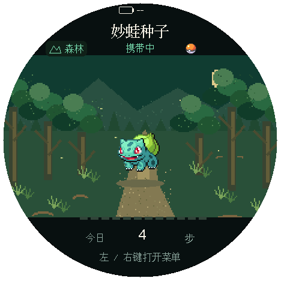
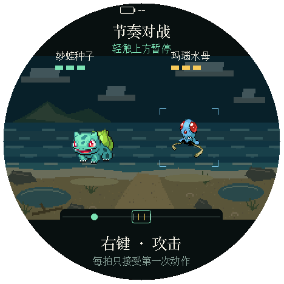
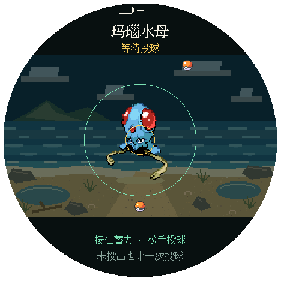
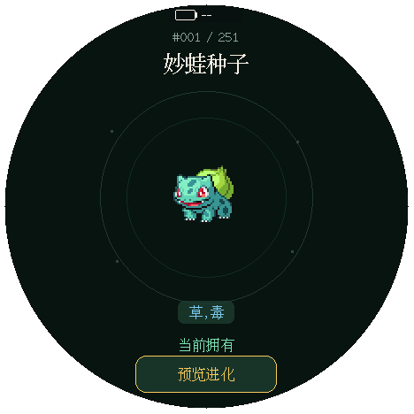
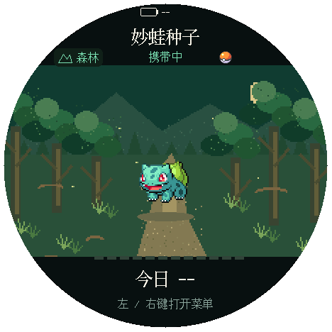
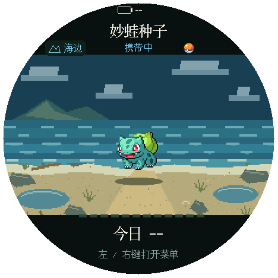
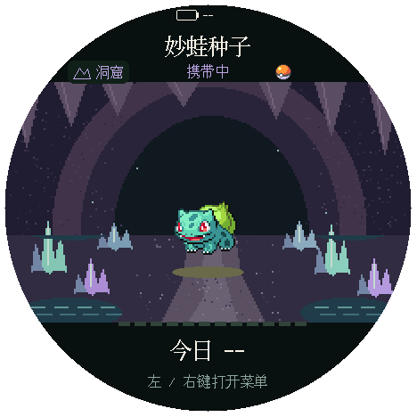

[中文](README.md) | **English**

<div align="center">

# PokeTrail · Pokémon Journey

Walk with your partner, encounter Pokémon, and catch them through rhythm battles and ball throws.<br>
An offline walking adventure for the round screen of the M5Stack StopWatch (C152).



[Getting started](#getting-started) · [Build and flash](#build-and-flash) · [Development guide (Chinese only)](docs/development.md) · [Verification notes (Chinese only)](docs/verification.md)

<sub><em>Unofficial fan project in development · Images are host Runtime/M5GFX renders, not device photos</em></sub>

</div>

## Gameplay

- **Walking adventures**: Explore forest, coast, and cave routes, each with its own encounter pool. An encounter occurs every 200–500 steps (random).
- **Rhythm battles and catching**: Attack or dodge to the beat. After winning, throw up to two balls; Poké Balls are unlimited. Catching a species permanently removes it from the encounter pool.
- **Partner training**: Carry one partner at a time. Only the carried partner earns training steps. Evolve it manually once it meets the requirements.
- **Pokédex**: Freely browse Kanto and Johto entries 1–251, with animated pixel art from Pokémon Black and White.

<p align="center">
  <a href="docs/images/readme/battle.png"></a>
  <a href="docs/images/readme/throw.png"></a>
  <a href="docs/images/readme/viewer.png"></a>
  <br>
  <sub>Rhythm battles · Charged throws · Pokédex · Host Runtime/M5GFX renders, not device photos</sub>
</p>

<p align="center">
  <a href="docs/images/readme/route-forest.png"></a>
  <a href="docs/images/readme/route-coast.png"></a>
  <a href="docs/images/readme/route-cave.png"></a>
  <br>
  <sub>Forest · Coast · Cave · Host Runtime/M5GFX renders, not device photos</sub>
</p>

See the [usage guide](docs/usage.en.md) for probabilities, evolution costs, controls, and save rules. See the [gameplay contract (Chinese only)](docs/design/walking-progression.md) for accounts and migration.

<details>
<summary>Image sources</summary>

All images are screenshots rendered offscreen with the host Runtime/M5GFX using the current code on 2026-10-29. They are not C152 device photos and cannot establish on-device frame rate, visual quality, or acceptance results. Click an image to open the original 468×468 file. The physical round screen is 466×466; the current M5GFX driver reports 468×468. The PNGs retain only pixels inside the round screen, with transparency outside it.

| Screen | Render suite | Screenshot |
| --- | --- | --- |
| Initial home screen | `test_home_render` | `home-today-complete-live`: the 4 steps today come from simulated walking in the test |
| Forest, coast, cave | `test_home_render` | `home-scene-0`–`home-scene-2`: today's count shows -- because the clock is not set |
| Rhythm battle, charged throw | `test_adventure_render` | `battle`, `throw-active`: coast route, facing Tentacool |
| Pokédex | `test_adventure_render` | `viewer-entry`: the starter partner in the test save |

The battery display shows -- because no battery reading was available during rendering. To regenerate:

```bash
rtk proxy mise exec -- python3 scripts/run_render_tests.py \
  test_home_render test_adventure_render
```

</details>

## Getting started

After flashing with the project's script, the device synchronizes its clock to the flashing computer's current time. Once storage is available, choose Bulbasaur, Charmander, or Squirtle as your starter partner. You can also set the clock manually on the device or leave it unset for now. Total steps and exploration continue to increase; steps recorded while the date is unknown are not added to today's count later.

On the home screen, press either side button or tap the screen to open the menu. The screen turns off after 30 seconds of inactivity; step counting and saving continue. A button press or touch first wakes the screen. See the [usage guide](docs/usage.en.md) for page controls.

## Build and flash

Use [mise](https://mise.jdx.dev/) for the development environment and run commands through [RTK](https://github.com/rtk-ai/rtk). Host regression tests also require a system C/C++ compiler; render regression tests require SDL2 and `sdl2-config`. The current verification environment is macOS. Linux and Windows have not been tested.

```bash
rtk proxy mise trust
rtk proxy mise install
rtk proxy mise exec -- python3 -m pip install -r requirements-dev.txt
rtk proxy mise run build
```

The repository includes all generated firmware data, so normal builds do not require downloading the Pokémon assets again. The first PlatformIO build requires network access to fetch the pinned toolchain and libraries. See the [development guide (Chinese only)](docs/development.md) for asset updates, test commands, and code ownership.

Before flashing, confirm the target device. Back up the entire Flash before replacing the factory firmware for the first time:

```bash
rtk proxy mise exec -- python3 scripts/detect_port.py
rtk proxy mise exec -- ./scripts/backup.sh /dev/cu.usbmodemXXXX
rtk proxy mise exec -- ./scripts/flash.sh /dev/cu.usbmodemXXXX
rtk proxy mise exec -- pio device monitor -p /dev/cu.usbmodemXXXX --baud 115200
```

The port above is a macOS example; replace it with the actual target. Automatic detection supports only macOS USB serial ports. Specify the port explicitly when multiple devices are connected. The backup script reads the device's **current** contents. A backup made after flashing custom firmware will not contain the factory image. Keep existing factory backups for the long term.

The flashing script builds and writes the bootloader, partition table, and application. It does not write a filesystem image. After the application starts, the script sends the computer's current time over USB serial. The device writes it to the RTC and save through the existing clock-setting transaction, then reads it back for confirmation. A device with a previously set clock keeps its time zone; the first clock setting uses the computer's current time zone offset. The computer's clock must be correct. Normal restarts use the RTC without setting the date again. Flashing with PlatformIO or esptool alone does not synchronize the clock.

If clock synchronization fails, the script reports that the firmware has already been written and exits with a nonzero status. Test mode, a busy device, or storage faults prevent automatic clock synchronization. The firmware requires a mountable LittleFS filesystem already present in the `spiffs` partition. **There is currently no way to format it for first use.** If a new device shows "Storage not initialized", the Pokédex remains available, but walking gameplay is unavailable. Preserve the original Flash contents. Initialize storage separately only after confirming the backup and the partition's purpose. Do not use automatic formatting to bypass mount errors.

## Hardware

The target device is the M5Stack StopWatch C152 with an ESP32-S3R8, 16 MB Flash, and 8 MB PSRAM. It uses a CO5300 AMOLED display and CST820B touch controller. The physical round screen is 466×466; the current M5GFX driver reports 468×468. The application leaves a margin around the circular edge.

- Facing the screen, `BtnA` (GPIO2) is on the left and `BtnB` (GPIO1) is on the right.
- The M5PM1 hardware powers the device off when you double-press the power button. On each boot, the firmware configures its LDO to maintain the 3.3V supply. The RTC keeps time while the device is off, so the clock need not be set again at startup. Standby power consumption while powered off has not been measured.
- To enter download mode manually, connect USB, hold the power button for about 2 seconds, and release it when the internal green LED lights up.
- The rear `BAT` sticker on the v1.0 batch is incorrect: the input is actually 5V IN and must not be connected to a battery. The label was corrected in v1.0.1.

## Documentation and licensing

An earlier firmware version booted on a C152 and reloaded a save. That observation does not mean device acceptance testing for the current schema5 is complete. See the [verification notes (Chinese only)](docs/verification.md) for current host checks, device observations, and pending checks for real step counting, physical interaction, RTC retention, power-loss recovery, and power consumption. Host tests cannot establish real step counting, on-device feel, latency, or power-loss recovery.

- [Usage guide](docs/usage.en.md): controls, catching, training, dates, and saves.
- [Development guide (Chinese only)](docs/development.md): environment, asset generation, tests, and module responsibilities.
- [Gameplay and migration contract (Chinese only)](docs/design/walking-progression.md): account invariants, evolution, and compatibility with older saves.
- [Verification notes (Chinese only)](docs/verification.md): scope of automated checks, current limitations, and pending device checks.

Original code is licensed under [MIT](LICENSE). Pokémon images, names, data snapshots, and third-party libraries are not covered by this project's MIT license. See [THIRD_PARTY_NOTICES.md](THIRD_PARTY_NOTICES.md) for sources and their respective notices. This project is not affiliated with or endorsed by Nintendo, Creatures, GAME FREAK, or The Pokémon Company.
