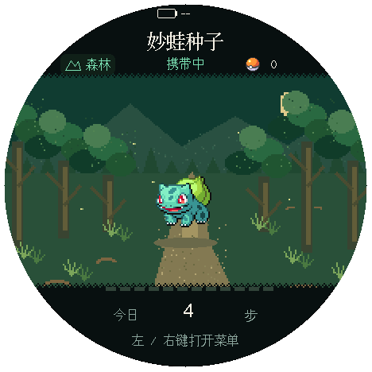
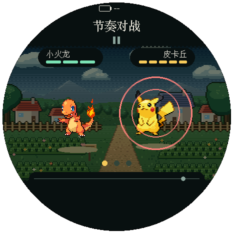
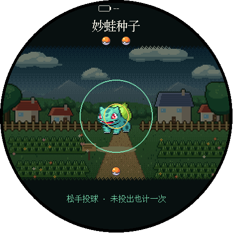
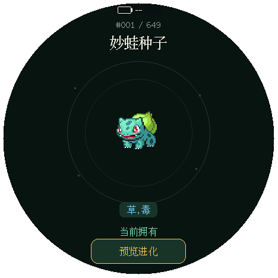
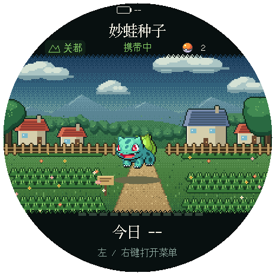
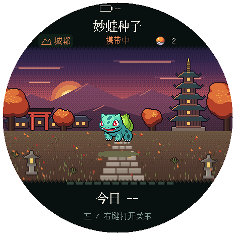
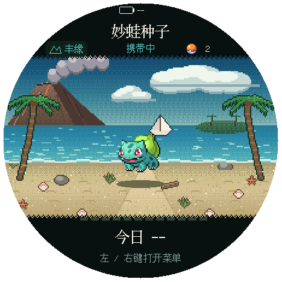
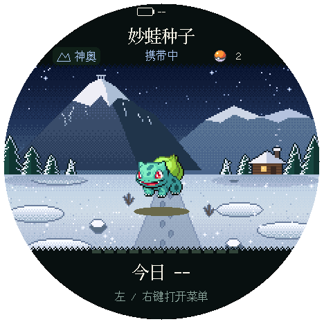
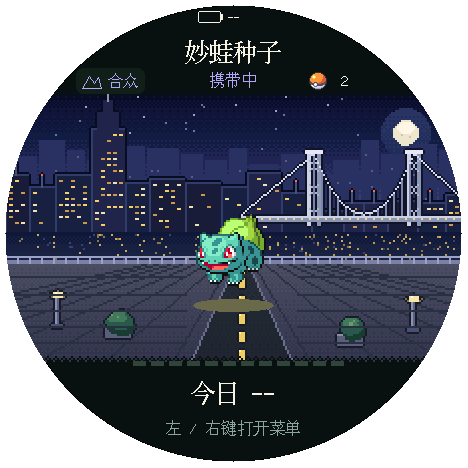

[中文](README.md) · [**English**](README.en.md)

<div align="center">

# PokeTrail · 宝可旅途

带着伙伴走路，遇见宝可梦，用节奏对战和投球完成捕捉。<br>
运行在 M5Stack StopWatch（C152）圆屏上的离线步行探险。



[开始使用](#开始使用) · [桌面模拟](#桌面模拟) · [构建和烧录](#构建和烧录) · [开发指南](docs/development.md) · [验证说明](docs/verification.md)

<sub>开发中的非官方爱好项目 · 画面为主机 Runtime/M5GFX 渲染，不是实机拍摄</sub>

</div>

## 玩法

- **走路探险**：关都、城都、丰缘、神奥、合众五个地区随时切换，每个地区只遇见本世代的宝可梦。每走 200–500 步（随机）产生一次遭遇，最多按顺序保留 32 场；菜单用“继续遭遇3”显示未开始对战的数量。
- **节奏对战与捕捉**：提示圈圈住对手就按右键攻击，圈住伙伴就按左键躲避，按键时机看收圈，底部轨道仅用中性小圆点预告下一拍。胜利后最多投两球；精灵球不限量。捕获、赠送领取或进化获得过的形态及其祖先不再出现在新遭遇中。
- **伙伴培养**：一次携带一只，只有携带者获得培养步。菜单“携带伙伴”直达当前伙伴的培养步与进化条件，可切换携带者、确认进化。
- **图鉴**：自由浏览全国图鉴 1～649，涵盖关都、城都、丰缘、神奥与合众，动画为《黑／白》像素素材。
- **中英文切换**：从菜单的“语言 / Language”选择中文或 English，保存后重启仍保留。宝可梦名称、属性和操作提示随语言切换。

<p align="center">
  <a href="docs/images/readme/battle-neutral-preview.png"></a>
  <a href="docs/images/readme/throw-single-ring.png"></a>
  <a href="docs/images/readme/viewer.png"></a>
  <br>
  <sub>节奏对战 · 蓄力投球 · 图鉴</sub>
</p>

<p align="center">
  <a href="docs/images/readme/region-kanto.png"></a>
  <a href="docs/images/readme/region-johto.png"></a>
  <a href="docs/images/readme/region-hoenn.png"></a>
  <a href="docs/images/readme/region-sinnoh.png"></a>
  <a href="docs/images/readme/region-unova.png"></a>
  <br>
  <sub>关都 · 城都 · 丰缘 · 神奥 · 合众</sub>
</p>

对战与捕获概率见[对战与投球](docs/usage-battle.md)，进化费用、按键和存档规则见[使用指南](docs/usage.md)。账户与迁移见[玩法契约](docs/design/walking-progression.md)。

<details>
<summary>画面来源</summary>

全部画面是 649 种版本用主机 Runtime/M5GFX 离屏渲染的截图；对战和投球画面更新于 2026-11-03，其余画面为 2026-11-02。不是 C152 实机拍摄，也不能当作实机帧率、观感或验收结果。点图片打开 468×468 原文件。物理圆屏为 466×466，当前 M5GFX 驱动报告 468×468；PNG 只保留圆屏内像素，圆外透明。

| 画面 | 当时的来源 | 截图 |
| --- | --- | --- |
| 首屏首页 | `test_home_render` | `home-today-complete-live`：今日 4 步来自测试中的模拟走路，尚未捕获 |
| 五个地区 | `test_home_render` 的旧地区场景 | `home-scene-0`～`home-scene-4`：未校时，所以今日显示 --；测试档已捕获 2 种 |
| 节奏对战 | 已删除的 `test_battle_render` | `battle-idle`：关都，小火龙对皮卡丘，攻击提示 |
| 蓄力投球 | `test_capture_render` 的旧瞄准场景 | `throw-aim-key-800`：关都，对手为妙蛙种子，按住 800ms，上方判定圈收拢，剩余两次 |
| 图鉴 | `test_adventure_render` 的旧旅程 | `viewer-entry`：测试档中的初始伙伴 |

电量处的 -- 是因为渲染时没有电池读数。2026-11-04 测试审计后，部分来源场景已删除，本页图片保留为历史展示。以下是现行首页渲染与对战／捕获 E2E 入口，会在新的验收目录输出实际场景证据，不会重建全部旧画面或自动替换本页图片：

```bash
rtk proxy mise exec -- python3 scripts/run_render_tests.py test_home_render
rtk proxy mise run test-simulator-e2e -- --case battle-cues --case capture
```

</details>

## 开始使用

开机先显示妙蛙种子动画与 PokeTrail 名称，至少停留 1.2 秒，再进入首次引导或恢复存档对应页面。存储错误会进入错误页。

使用项目烧录脚本后，设备会同步烧录电脑的当前时间。存储可用后选择妙蛙种子、小火龙或杰尼龟作为初始伙伴。也可以在设备上手动校时，或暂不校时：累计步数与探索照常增加，未知日期期间的步数不会补填到今日。

首次日期引导的第二页也有“语言 / Language”，可先切成英文再继续。新档和旧档升级默认中文。保存失败先重试；存储无法加载时可临时切换语言浏览图鉴，重启不保留。详情见[语言设置](docs/usage.md#语言设置)。

首页点按任一侧键或轻触屏幕进入菜单。30 秒无操作后熄屏，计步和保存继续；熄屏后仅短按电源键可点亮屏幕，触摸和侧键不会唤醒。页面操作见[使用指南](docs/usage.md)。

## 桌面模拟

安装下方开发环境和 SDL2 后，无需连接设备即可打开桌面窗口：

```bash
rtk proxy mise run simulate
```

左右方向键对应两侧按键，`Enter` 双键确认，鼠标点按／拖动模拟触摸。`W` 开关走路，`Tab` 切换 16 倍时间，`P` 唤醒。存档独立保存在 `.simulator/save/`。完整操作、依赖和限制见[桌面模拟指南](docs/simulator.md)。

## 构建和烧录

使用 [mise](https://mise.jdx.dev/) 管理开发环境，命令通过 [RTK](https://github.com/rtk-ai/rtk) 执行。主机回归还需系统 C/C++ 编译器，渲染回归需 SDL2 及 `sdl2-config`。当前验证环境为 macOS；Linux 和 Windows 尚未实跑。

```bash
rtk proxy mise trust
rtk proxy mise install
rtk proxy mise exec -- python3 -m pip install -r requirements-dev.txt
rtk proxy mise run build
```

仓库包含完整生成的固件数据，普通构建无需重新下载宝可梦素材。PlatformIO 首次构建需要联网获取固定版本的工具链和库。素材更新、测试命令和代码归属见[开发指南](docs/development.md)。

烧录前确认目标设备，首次覆盖出厂固件前备份整片 Flash：

```bash
rtk proxy mise exec -- python3 scripts/detect_port.py
rtk proxy mise exec -- ./scripts/backup.sh /dev/cu.usbmodemXXXX
rtk proxy mise exec -- ./scripts/flash.sh /dev/cu.usbmodemXXXX
rtk proxy mise exec -- pio device monitor -p /dev/cu.usbmodemXXXX --baud 115200
```

以上端口是 macOS 示例，应替换为实际目标；自动探测仅支持 macOS USB 串口，多个设备时请显式指定。备份脚本读取设备**当前**内容，刷入自定义固件后再备份不会得到出厂镜像。已有出厂备份请长期保留。

烧录脚本构建并写入 bootloader、分区表和应用，不写入文件系统镜像。应用启动后，脚本通过 USB 串口发送电脑当前时间，设备按现有校时事务写入 RTC 和存档，再回读确认。已校准设备保留原时区，首次校准采用电脑当前时区偏移；电脑时间须正确。普通重启沿用 RTC，不重复设置日期。仅使用 PlatformIO 或 esptool 写入固件不会执行这一步。

校时失败时脚本会说明固件已经写入，并以非零状态退出。测试模式、设备忙或存储故障会阻止自动校时。固件要求 `spiffs` 分区已有可挂载的 LittleFS；**当前没有首次格式化入口**。新设备若显示“存储未初始化”，图鉴仍可浏览，步行玩法不可用。请保留原 Flash，在确认备份和分区用途后另行初始化；不要用自动格式化绕过挂载错误。

## 硬件

目标设备为 ESP32-S3R8、16 MB Flash、8 MB PSRAM 的 M5Stack StopWatch C152，使用 CO5300 AMOLED 和 CST820B 触摸。物理圆屏 466×466，当前 M5GFX 驱动报告 468×468，应用留有圆形边缘余量。

- 面向屏幕时，左侧为 `BtnA`（GPIO2），右侧为 `BtnB`（GPIO1）。
- 双击电源键关机由 M5PM1 硬件执行。固件每次开机设置其 LDO 3.3V 电源保持，RTC 在关机期间继续走时，开机不需要重新校时；关机静态功耗待测。
- 手动进入下载模式：连接 USB，长按电源键约 2 秒，内部绿灯亮起后松开。
- 部分 v1.0 批次背面误标 `BAT`，实际为 5V IN，不能接电池；v1.0.1 硬件已把该引脚改为真正的 BAT。接线前按[官方硬件版本说明](https://docs.m5stack.com/en/core/StopWatch)确认设备版本。

## 文档与许可

2026-10-30 的 649 种固件曾在 C152 启动并重载存档；这次有限观察早于 schema7 五地区版本，不代表当前固件的完整设备验收已完成。当前主机检查、设备观察，以及真实计步、实体交互、RTC 保持、断电恢复和功耗的待验项，见[验证说明](docs/verification.md)。

- [使用指南](docs/usage.md)：操作、捕捉、培养、日期与存档。
- [对战与投球](docs/usage-battle.md)：提示圈、判定窗口、必杀、振动、投球概率与捕获练习。
- [Usage guide (English)](docs/usage.en.md)：English version of the usage guide.
- [桌面模拟指南](docs/simulator.md)：键鼠操作、独立存档与模拟边界。
- [开发指南](docs/development.md)：环境、素材生成、测试与模块职责。
- [玩法与迁移契约](docs/design/walking-progression.md)：账户不变量、进化、旧档兼容。
- [验证说明](docs/verification.md)：自动检查范围、当前限制和设备待验项。
- [设备观察记录](docs/device-observations.md)：历次实机观察与本地证据索引。

自写代码采用 [MIT](LICENSE) 许可证。宝可梦图像、名称、资料快照和第三方库不纳入本项目 MIT 授权；来源与各自声明见 [THIRD_PARTY_NOTICES.md](THIRD_PARTY_NOTICES.md)。本项目与 Nintendo、Creatures、GAME FREAK 或 The Pokémon Company 无关联，也不代表其认可。
