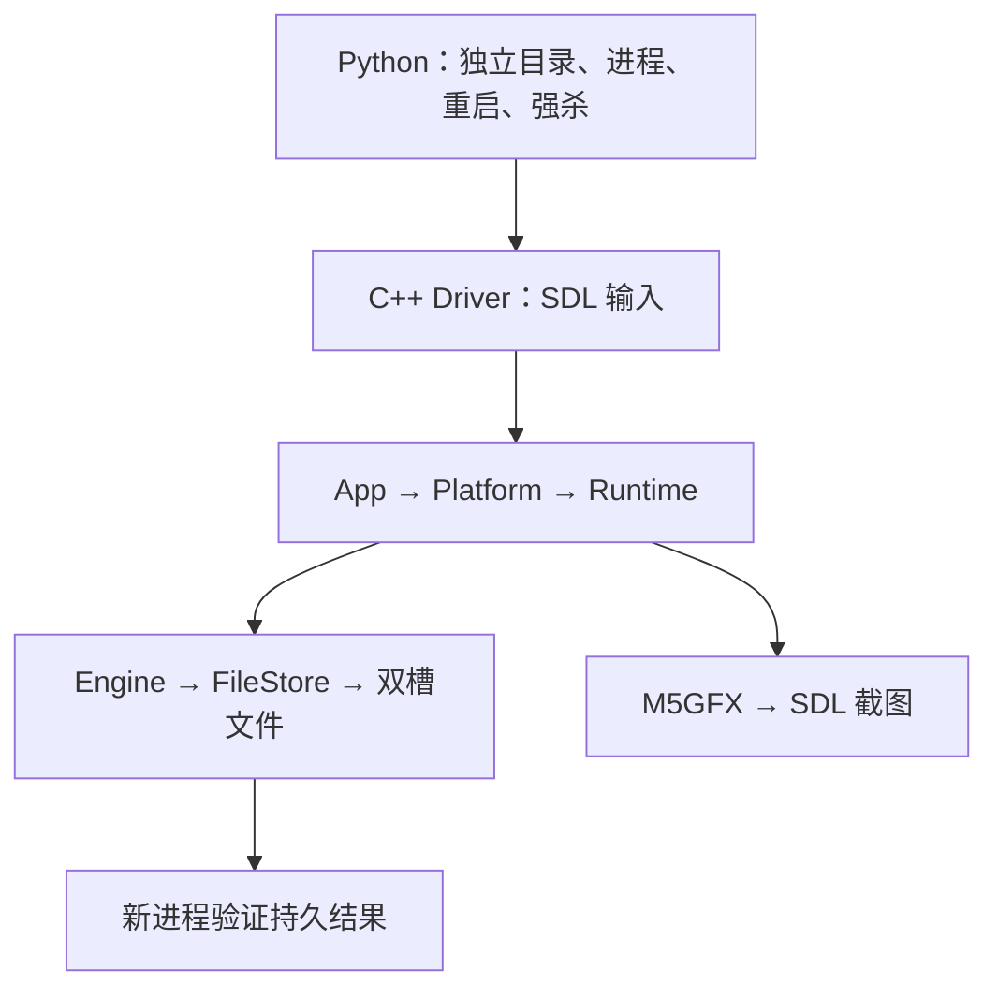

# 模拟器 E2E

本文维护已实现的测试结构与证据格式，场景覆盖见[覆盖矩阵](simulator-e2e-coverage.md)。运行 `rtk proxy mise run test-simulator-e2e` 后，以本轮输出判断结果；已知失败与设备边界见[验证说明](../verification.md)。

测试从桌面输入进入真实 Runtime、玩法和 M5GFX，将结果写入真实双槽文件，再启动新进程验证恢复。当前源码使用 schema9、ruleVersion 3，新档从关都出发。SDL 事件队列证明应用层输入接入；操作系统键鼠和实体设备另行验收。

## 结构与归属

采用 C++ 场景驱动与 Python 进程编排，共用 [host_build.py](../../scripts/host_build.py) 的编译入口及固件源文件列表。



C++ Driver 复用 SDL 输入与固件类型；Python 管理独立进程和文件。OS 键鼠自动化是额外验收，不计入 SDL 队列测试的通过范围。

- [test/simulator](../../test/simulator)：输入、场景、断言、业务快照、fixture 生成器。场景只能取得 const Runtime/Save，不通过可变 Engine 制造结果。
- [simulator](../../simulator)：固定种子和墙钟、错误展示、窗口事件观察、存储故障接缝。正常桌面模式仍保留阻塞错误框和关闭失败保护。
- [run_simulator_e2e.py](../../scripts/run_simulator_e2e.py)：构建、独立目录、启动、重载、FIFO/SIGKILL、超时和结果汇总。
- [test/fixtures/simulator](../../test/fixtures/simulator)：历史 schema3/rule2、schema6 海边在途场、schema7 培养账户与 schema8 单场遭遇字节，清单按文件记录来源提交、源文件、生成器和字节哈希。重建命令为 `rtk proxy mise exec -- python3 scripts/build_simulator_legacy_fixture.py`。

调用示例与实际 [Driver](../../test/simulator/driver.hpp) 一致：

```cpp
d.press(SDL_SCANCODE_RIGHT);
d.select(4);
d.until([&] { return d.screen().page == Page::Viewer; },
        4000, "viewer opens");
d.shot("viewer");
d.close();
```

按键和触摸保留 down/up tick，普通页面跳转等待释放门；滑动保留移动轨迹。屏幕坐标由 Driver 转换到窗口 `(50,24)` 起点。正常 `close()` 必须确认退出，故障场景显式要求 `Close::Protected`，清除故障后再确认正常退出。

## 确定性

默认主种子为 `20261031`，起始 UTC 为 `1793376000`；跨日场景为 `1793375990`。墙钟来自起始 UTC 与逻辑 elapsed，Storage 的 `clock.txt` 也使用同一来源。重启由 runner 增加已执行逻辑时间及离线间隔：通常5秒，跨日与回拨场景为1小时。

每次 Runtime loop 为20 ms；W 使用真实 detector 处理合成步态。16倍模式仅用于走路，战斗使用1倍。等待有逻辑上限，Python 每次进程等待有120秒 watchdog；强杀握手另有120秒期限。失败不自动重试。

普通战斗驱动读取当前可见的 `shownAction` 来选择按键，不读 `BattleView.expected`。`battle-cues` 另检查真实画面中的提示圈与按键判定一致。`battle-fixed` 保留独立输入：战斗页开始后 2012、3512、4612、5712、6812ms 依次按右、右、左、左、右，不根据当前提示决定方向，断言能获胜并进入投球页。固定输入有独立行为价值，不依赖整屏哈希。

捕获场景用固定种子复现成功、失败和重试，断言投球结果、次数、账户、记录及新进程恢复；不再把完整 seed／roll／probability 数值组合冻结为 E2E 契约。英文捕获场景仍检查 #116 Horsea 的名称与属性可读。捕获概率阈值由 `test-adventure` 的独立边界检查承担。

2026-11-03 的首帧像素比较属于当时的历史证据，保留于 [cue-pixel-review.json](../../.pio/verification/simulator-e2e-20261103T091103.877196Z/battle-fixed/cue-pixel-review.json)。当前 runner 已删除整屏哈希分支，也不再生成逐拍 `fixed-cue-*` 截图；历史比较结果不能代表本轮测试通过。

GUI 串行运行，实际窗口事件写入日志。E2E 开启 `isolateHostFocus`：宿主窗口的失焦事件仍记录，但不改变脚本输入；Driver 主动注入的 `windowID=0` 失焦事件照常进入 Platform，验证释放按键、停止走路和结算蓄力。正常桌面模式不开启隔离，宿主失焦照常处理。旧 smoke 的真实窗口 ID 路径不再单独自动测试，原生 OS 输入与焦点仍需人工验证。原始事件、截图和业务结果保留作诊断证据，不要求整屏像素完全一致。

## fixture 与故障

N 表示新档旅程，F 表示合法 fixture 起步，X 表示预制坏文件。F 证明起点之后的操作链，不宣称此前培养步来自用户走路。

当前 fixture 经生产 codec 编解码、语义校验及 FileStore 加载。旧格式使用冻结旧字节：v1 引用已有 progression fixture；schema3/rule2 由历史提交 `53ebf948c998af69b1da06f125c224ccb4f44ccc` 的编码器生成；schema6 由五地区改动前的提交 `05432f6138310b5e9507cad4d25a525ecadd32b2` 的编码器生成，含选定海边、海边在途 #072（ThrowReady）和一条森林 #016 捕捉记录。schema3/rule2 升级为 rule3；v1 在途场仍保留 rule1，检查库存并扣球；schema6 升级为关都，在途场改到关都，森林记录保留。schema7 培养样本由提交 `95df92f1f89d9b087107ab5829db1721b3f6883f` 的编码器生成，包含总步 7800、妙蛙种子培养 7600、妙蛙草历史培养 200 和已拥有的小火龙；升级默认中文且保留账户。schema8 单场样本由提交 `c5a99dd` 的编码器生成，包含 300 步、零余额与关都 #072 EncounterReady，升级后经真实走路继续建场并重启核对 FIFO 快照。`sinnoh-done` 是当前格式的 F 起点：神奥 38 种普通种均已在神奥捕获，探索余额 400 步。

`history-evolution` 用当前格式登记所有普通种、但不制造捕获记录，真实进化赠送种子并验证全地区耗尽；`history-branches` 在两条相关进化链中只登记雷丘和战舞郎，省略皮丘、皮卡丘、无畏小子与两只格斗旁支，另登记关都／城都其余普通种，验证跨世代、缺中间历史的祖先闭包与未获得旁支；`history-pending` 构造旧规则下合法的种子在途场（来源已进化、未曾捕获），验证新抽样规则不会阻止完成该场。三者都是 F 起点，不冒充历史版本冻结字节或用户真实存档；均通过真实文件与新进程验证结果。

故障在真实 SlotIO 外包一层适配，不替换 FileStore 或 codec。场景显式武装并解除故障，记录命中次数。

| 故障 | 验证行为 |
| --- | --- |
| 写前报错 | 新奖励未发布，旧槽可恢复 |
| 完整写后报错 | 错误页不发奖励；重试识别同一候选 |
| 回读错误 | 已写结果不提前发布；恢复后确认一次 |
| 部分写入 | 新槽截断；强杀后恢复旧有效槽 |
| 时钟写失败 | 关闭失败保留窗口，恢复后可退出 |
| 慢写入 | 真实写盘后将逻辑时钟推进5000ms；保存返回后仍完整播放飞行，捕获记录可由新进程恢复 |

FileStore 在 write 返回 false 后立即结束本次提交；下次重试扫描同 sequence、同字节候选。写后报错的有效新槽可能已经持久化，强杀恢复应采用该槽，不能强制回退到最后一次 UI 已确认状态。

强杀场景先截图和快照，flush `kill-ready`，写 FIFO，然后停在系统 `pause()`。此时不再推进 Runtime、绘制或逻辑时间，文件锁仍保留。Python 收到握手后发送 SIGKILL，再启动新进程核对实际磁盘恢复。普通退出始终走 SDL_QUIT。

## 执行与证据

新功能必须新增对应的 E2E 操作链与断言，接入默认全量运行并更新上方矩阵；新增覆盖不自动要求跑全量。局部改动默认用相关筛选场景完成验收，纯文档等非行为改动不跑 E2E。仅在跨流程核心行为、存档协议／迁移、全局测试基础设施等触发条件成立时，或明确要求完整回归时执行全量；边界见[验证指南](../verification.md#每次任务的-e2e-验收要求)。仅编译不证明行为通过，失败或环境阻塞须明确报告。

```bash
rtk proxy mise run test-simulator-e2e
rtk proxy mise run test-simulator-e2e -- --suite core
rtk proxy mise run test-simulator-e2e -- --case retry-after
rtk proxy mise run test-simulator-e2e -- --build-only
```

输出为 `.pio/verification/simulator-e2e-时间戳/`。`MYM5_VERIFICATION_DIR` 可指定尚不存在的目录。每个场景独立，后续阶段复用该场景存档，既有个人存档与历史验收目录不会被覆盖。

- 根目录 `manifest.json`：HEAD、dirty 状态、源码及二进制哈希、seed、UTC、系统、Python、编译器、SDL版本。
- 根目录 `result.json`：每个场景的ID、起点、状态和错误。
- 场景 `fixture.json`、`before/`、`after.json`、`save/`：初始字节及哈希、终态哈希与真实存档。中间文件哈希不能替代最终业务断言。
- 各启动目录：`events.jsonl`、`stdout.log`、`stderr.log`、`result.json`、命名业务快照、BMP/PNG截图；进程结果含退出码、墙钟耗时与是否强杀。
- `restart-check.json`：跨进程时钟与账户比较；`language-disk-check.json`：显示语言与 CRC 有效磁盘槽的核对；`queue-restart-check.json`：跨进程核对活动场、FIFO 顺序与完整生成快照、计数及探索账目。

首次断言失败保留快照与截图并退出，runner 继续其他独立场景。超时也保留进程结果；最近截图和日志仍可查看。构建依赖或SDL不可用时命令非零退出，不记为通过。

## 验证边界

当前默认 E2E 注册 47 场（P0 26、P1 21），渲染入口保留 12 套。`test-adventure`、`test-storage`、`test-render` 及素材检查分别承担规则边界、故障恢复、页面信息和发布来源验证。独立 smoke／`test-simulator` 入口已删除，普通集成路径由 E2E 承担；只构建桌面程序可用 `rtk proxy mise run simulate -- --build-only`。没有独立 typecheck 任务，C++ 类型检查由实际主机与固件编译承担。

实际文字、圆屏输出和输入检查与人工视觉审阅各有边界；截图不是固定整屏像素基准。画布468×468，物理圆屏466×466；主机图无法证明设备边缘可见性、真实计步、时延或断电恢复。注册数量只描述当前源码，验收状态须看本轮结果。

本地验证使用 macOS Cocoa；Ubuntu 的 X11/Xvfb 路径由 [GitHub Actions](../../.github/workflows/simulator-e2e.yml) 逐提交执行，以对应 CI 结果为准。Linux 真实桌面人工操作与原生 OS 输入尚未验收；实体设备仅有[有限历史观察](../verification.md#设备观察与待验事项)。渲染的已知失败统一见[验证说明](../verification.md#已知失败与限制)，不能把 E2E 通过写成全部渲染通过。
