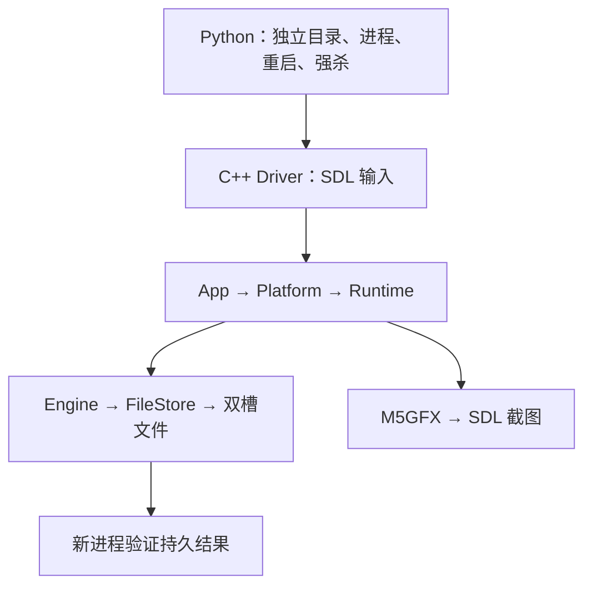

# 模拟器 E2E

本文维护已实现的测试结构、覆盖矩阵与证据格式。运行 `rtk proxy mise run test-simulator-e2e` 后，以本轮输出判断结果；已知失败与设备边界见[验证说明](../verification.md)。

测试从桌面输入进入真实 Runtime、玩法和 M5GFX，将结果写入真实双槽文件，再启动新进程验证恢复。当前源码使用 schema6、ruleVersion 3。SDL 事件队列证明应用层输入接入；操作系统键鼠和实体设备另行验收。

## 结构与归属

采用 C++ 场景驱动与 Python 进程编排，共用 [host_build.py](../../scripts/host_build.py) 的编译入口及固件源文件列表。



C++ Driver 复用 SDL 输入与固件类型；Python 管理独立进程和文件。OS 键鼠自动化是额外验收，不计入 SDL 队列测试的通过范围。

- [test/simulator](../../test/simulator)：输入、场景、断言、业务快照、fixture 生成器。场景只能取得 const Runtime/Save，不通过可变 Engine 制造结果。
- [simulator](../../simulator)：固定种子和墙钟、错误展示、窗口事件观察、存储故障接缝。正常桌面模式仍保留阻塞错误框和关闭失败保护。
- [run_simulator_e2e.py](../../scripts/run_simulator_e2e.py)：构建、独立目录、启动、重载、FIFO/SIGKILL、超时和结果汇总。
- [test/fixtures/simulator](../../test/fixtures/simulator)：历史 schema3/rule2 字节和来源哈希。重建命令为 `rtk proxy mise exec -- python3 scripts/build_simulator_legacy_fixture.py`。

调用示例与实际 [Driver](../../test/simulator/driver.hpp) 一致：

```cpp
d.press(SDL_SCANCODE_RIGHT);
d.select(3);
d.until([&] { return d.screen().page == Page::Viewer; },
        4000, "viewer opens");
d.shot("viewer");
d.close();
```

按键和触摸保留 down/up tick，普通页面跳转等待释放门；滑动保留移动轨迹。屏幕坐标由 Driver 转换到窗口 `(50,24)` 起点。正常 `close()` 必须确认退出，故障场景显式要求 `Close::Protected`，清除故障后再确认正常退出。

## 确定性

默认主种子为 `20261031`，起始 UTC 为 `1793376000`；跨日场景为 `1793375990`。墙钟来自起始 UTC 与逻辑 elapsed，Storage 的 `clock.txt` 也使用同一来源。重启由 runner 增加已执行逻辑时间及离线间隔：通常5秒，跨日与回拨场景为1小时。

每次 Runtime loop 为20 ms；W 使用真实 detector 处理合成步态。16倍模式仅用于走路，战斗使用1倍。等待有逻辑上限，Python 每次进程等待有120秒 watchdog；强杀握手另有120秒期限。失败不自动重试。

通常的战斗驱动只读取当前可见的 `shownAction`，不读 `BattleView.expected`。`battle-fixed` 额外重放冻结轨迹：战斗页开始后的1400、2900、4000、5100、6200 ms，依次按右、右、左、左、右；不观察提示来选择输入。第一帧提示圆屏 RGB 与留存轨迹的 SHA256 比较，其余提示也截图留证。

捕获预期来自固定运行记录，不用生产概率函数生成断言，也不搜索种子直到成功：新档首场为 #590、seed `1745833800`，Perfect 为 roll33／概率90；投球 fixture 为 #072、seed `0x2468ace0`，两次 Miss 为 roll16、roll5／概率0，Perfect 重试为 roll16。

GUI 串行运行，实际窗口事件写入日志。E2E 开启 `isolateHostFocus`：宿主窗口的失焦事件仍记录，但不改变脚本输入；Driver 主动注入的 `windowID=0` 失焦事件照常进入 Platform，验证释放按键、停止走路和结算蓄力。正常桌面模式不开启隔离，宿主失焦照常处理，`test-simulator` 用真实窗口 ID 验证释放。相同新档输入在独立目录运行，比较逻辑输入事件、业务结果和截图；受桌面影响的 OS 事件不参与重复性比较，原始日志完整保留。

## fixture 与故障

N 表示新档旅程，F 表示合法 fixture 起步，X 表示预制坏文件。F 证明起点之后的操作链，不宣称此前培养步来自用户走路。

当前 fixture 经生产 codec 编解码、语义校验及 FileStore 加载。旧格式使用冻结旧字节：v1 引用已有 progression fixture；schema3/rule2 由历史提交 `53ebf948c998af69b1da06f125c224ccb4f44ccc` 的编码器生成，清单记录历史源文件、生成器和字节哈希。schema3/rule2 升级为 rule3；v1 在途场仍保留 rule1，检查库存并扣球。

故障在真实 SlotIO 外包一层适配，不替换 FileStore 或 codec。场景显式武装并解除故障，记录命中次数。

| 故障 | 验证行为 |
| --- | --- |
| 写前报错 | 新奖励未发布，旧槽可恢复 |
| 完整写后报错 | 错误页不发奖励；重试识别同一候选 |
| 回读错误 | 已写结果不提前发布；恢复后确认一次 |
| 部分写入 | 新槽截断；强杀后恢复旧有效槽 |
| 时钟写失败 | 关闭失败保留窗口，恢复后可退出 |
| 慢写入 | 真实写盘后将逻辑时钟推进5000ms；保存返回后仍完整播放飞行，捕获记录可由新进程恢复 |

FileStore 在 write 返回 false 后立即结束本次提交；下次重试扫描同 sequence、同字节候选。写后报错的有效新槽可能已经持久化，强杀恢复应采用该槽，不能强制回退到最后一次 UI 已确认状态。

强杀场景先截图和快照，flush `kill-ready`，写 FIFO，然后停在系统 `pause()`。此时不再推进 Runtime、绘制或逻辑时间，文件锁仍保留。Python 收到握手后发送 SIGKILL，再启动新进程核对实际磁盘恢复。普通退出始终走 SDL_QUIT。

## 覆盖矩阵

默认全量运行 29 场：P0 16 场、P1 13 场。`--suite core` 仅运行 P0。所有场景名称以 runner 的 `CASES` 为准。

| ID／起点 | 场景 | 核心断言 |
| --- | --- | --- |
| P0-01／N | journey | 引导、伙伴、图鉴、W计步、遭遇、正常关闭和重载 |
| P0-02／N | capture、battle-fixed、capture-slow-save | 真实胜利与捕获；#590图鉴、伙伴、首捕卡；两页捕获徽标从0到1及重载像素检查；投球页无静态球徽标；保存后飞行起点、攻击／躲避结果文字与成功保留帧像素；slow-save 在真实写盘中注入5000ms逻辑时间延迟，仍从飞行开始并通过新进程恢复；动画期间投球次数、奖励不变，允许正常后台checkpoint |
| P0-03／F | throws、aim | 两次Miss逃脱、球不扣库；throws 检查挣脱文字与结果保留阶段，动画不重复消耗机会或发放奖励；瞄准态空等与轻触不消耗机会，左键按住时右键／触摸短按仍可取消，按住才起算窗口，重载回到瞄准态 |
| P0-04／F | retry-before/after/readback | 提交前无奖励；重试同一attempt；按住重试不能连带确认结果 |
| P0-05／F | progression | 只有携带者获步；来源扣7500，目标使用自己200历史步；重载不重扣；进化及重载后两页捕获种数仍为0 |
| P0-06／F | target-owned、evolution-retry | 目标已有则整笔拒绝；保存失败不播进化，重试一次并持久化 |
| P0-07／F、X | storage | 有效+截断恢复；双坏、未来版本、目录锁拒绝且文件不变 |
| P0-08／F | crash-pause/write/partial | 暂停、写后报错、部分写后三种SIGKILL及新进程账户恢复 |
| P1-09／F | isolation | 预览、分支、练习不改真实账户；静止区间不写槽 |
| P1-10／N | clock、capture-clock | 未知步数/捕获不回填；UI校时、新步可信、重载UTC与账户 |
| P1-11／F | midnight | 自然跨日、回拨一天归档、epoch增加一次、离线1小时及重载 |
| P1-12／旧F | migration、migration-activity、migration-rule2 | rule1零球时可先后按住双键确认投球页出口、活动场退休、rule2升级rule3继续投球 |
| P1-13／F | lifecycle-* | 触摸不唤醒、P唤醒、宿主焦点隔离与脚本失焦停步/释放、蓄力关闭、两类关闭失败保护 |
| P1-14／F | edges | 长名、图鉴、伊布分支末页和返回；真实截图供视觉审阅 |
| P1-15／N | 尚未接入默认 runner | 原生 OS 键鼠路径待验收；不计入上述 29 场 |

预览和练习的零写入在启动已提交、关闭步态且时钟稳定的区间判断。正常启动、checkpoint、关闭可能合法写槽，不能对整个场景笼统要求字节不变。重启允许 sequence/bootGeneration 变化；时钟场景另比较 UTC（1秒容差）、日桶、历史、epoch、总账与培养账户。

## 执行与证据

新功能必须新增对应的 E2E 操作链与断言，接入默认全量运行并更新上方矩阵。每次仓库任务最终改动完成后、报告完成前必须执行全量命令，包括仅修改文档的任务。筛选场景和仅编译用于开发调试，不能代替交付检查；失败或环境阻塞须明确报告。统一要求见[验证指南](../verification.md#每次任务的-e2e-验收要求)。

```bash
rtk proxy mise run test-simulator-e2e
rtk proxy mise run test-simulator-e2e -- --suite core
rtk proxy mise run test-simulator-e2e -- --case retry-after
rtk proxy mise run test-simulator-e2e -- --build-only
```

输出为 `.pio/verification/simulator-e2e-时间戳/`。`MYM5_VERIFICATION_DIR` 可指定尚不存在的目录。每个场景独立，后续阶段复用该场景存档，既有个人存档与历史验收目录不会被覆盖。

- 根目录 `manifest.json`：HEAD、dirty 状态、源码及二进制哈希、seed、UTC、系统、Python、编译器、SDL版本。
- 根目录 `result.json`：每个场景的ID、起点、状态和错误。
- 场景 `fixture.json`、`before/`、`after.json`、`save/`：初始字节及哈希、终态哈希与真实存档。中间文件哈希不能替代最终业务断言。
- 各启动目录：`events.jsonl`、`stdout.log`、`stderr.log`、`result.json`、命名业务快照、BMP/PNG截图；进程结果含退出码、墙钟耗时与是否强杀。
- `restart-check.json` 和 `cue-check.json`：跨进程时钟账户比较与固定战斗提示像素比较。

首次断言失败保留快照与截图并退出，runner 继续其他独立场景。超时也保留进程结果；最近截图和日志仍可查看。构建依赖或SDL不可用时命令非零退出，不记为通过。

## 验证边界

已有 `test-adventure`、`test-storage`、`test-render`、`test-simulator` 继续承担各自职责。E2E 不替代649物种素材校验、全部进化边或概率统计。

SDL/M5GFX像素一致、固定截图回归、人工视觉审阅分别证明不同内容。画布468×468，物理圆屏466×466；主机图无法证明设备边缘可见性、真实计步、时延或断电恢复。

本地验证使用 macOS Cocoa；Ubuntu 的 X11/Xvfb 路径由 [GitHub Actions](../../.github/workflows/simulator-e2e.yml) 逐提交执行，以对应 CI 结果为准。Linux 真实桌面人工操作与原生 OS 输入尚未验收；实体设备仅有[有限历史观察](../verification.md#设备观察与待验事项)。渲染的已知失败统一见[验证说明](../verification.md#已知失败与限制)，不能把 E2E 通过写成全部渲染通过。
