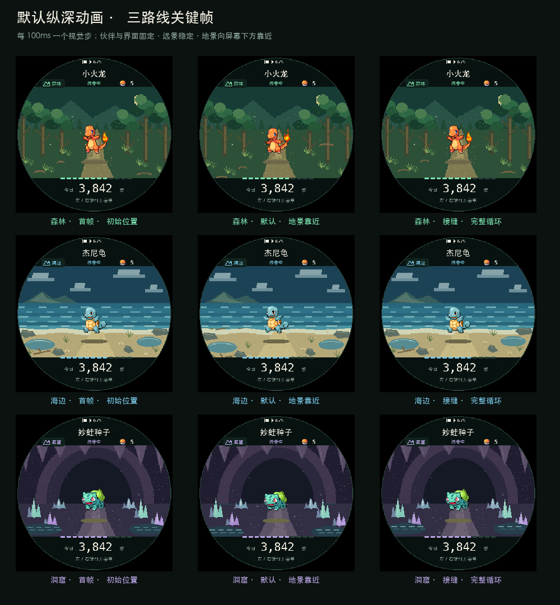
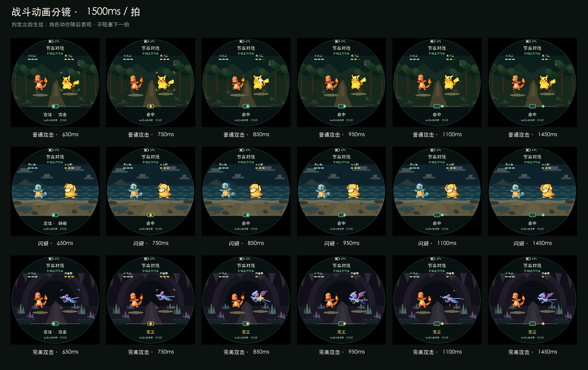

# 步行、战斗与捕获设计规格

返回[视觉设计](ui-scene-redesign.md)和[26 个页面覆盖](ui-scene-redesign-pages.md)。

## 步行纵深

播放设计稿：[森林](ui-scene-redesign/animations/walk-forest.gif) · [海边](ui-scene-redesign/animations/walk-coast.gif) · [洞窟](ui-scene-redesign/animations/walk-cave.gif)

这些 GIF 是 Pillow 主机设计预览，不是 Runtime/M5GFX 或实体设备录像，也不作为 C152 帧率证据。固件已实现同一纵深契约，真实渲染证据见[实现与验收](ui-scene-redesign-implementation.md)。

| 路线 | 固定远景 | 向屏幕下方靠近的地景 |
| --- | --- | --- |
| 森林 | 天空、远山、树干、树冠与林径底色 | 草、根系和路面颗粒 |
| 海边 | 云、远岛、海浪与沙滩底色 | 潮池、岸边石块、草、贝壳和漂流木 |
| 洞窟 | 岩拱、钟乳石、晶簇与石径底色 | 地下水面和路面颗粒 |

中层地景每个视觉步下移 1 个源像素，近层地景下移 2 个源像素，再按最近邻放大 2 倍。移动方向表示景物从路线前方靠近观察者，不做左右平移。森林、海边和洞窟分别按 51、44、49 源像素的地面带高度循环，没有亚像素插值或透明补边。伙伴、接触影、标题、路线、球数、进度、今日步数和操作提示不参与位移。

每条 GIF 使用 4000ms 时间轴，每槽 100ms，每槽推进 1 个视觉步，整段共 40 个视觉步。GIF 编码可以合并完全相同的相邻画面，但合并后的持续时间仍对应这些时间槽。

固件遵守以下契约：

- 首页在屏幕唤醒时每 100ms 默认推进一次，不要求走路输入；走路不改变动画速率。
- 路线切换显示该路线的静止首帧。菜单和熄屏期间暂停，返回首页和唤醒保留当前视觉位置，不重新开始伙伴原动画。
- 展示层持有视觉进度，绘制函数只读。Engine、奖励、遭遇、培养和存档不保存这份进度。
- 遭遇、对战和投球继续使用静态暗色场景。战斗只保留既有震动，不叠加步行位移。
- 已通过默认时间轴、真实 IMU 输入和 Runtime/M5GFX 截图验收；实体 C152 另验圆屏观感与绘制耗时。

## 战斗动画

播放设计稿：[普通攻击](ui-scene-redesign/animations/battle-attack.gif) · [闪避](ui-scene-redesign/animations/battle-dodge.gif) · [完美攻击](ui-scene-redesign/animations/battle-perfect.gif)

战斗采用伙伴在左、对手在右的双角色站位。两条角色动画使用独立播放位置，并按原始帧持续时间推进；出招不会重新开始角色的待机动画。

| 动画 | 路线与角色 | 表现与示例结果 |
| --- | --- | --- |
| 普通攻击 | 森林；小火龙对皮卡丘 | 伙伴前冲后返回，对手闪白、后退并出现碎光；对手 HP 3→2，显示“命中” |
| 闪避 | 海边；杰尼龟对可达鸭 | 对手先出手，伙伴侧移并留下两层残影；伙伴 HP 保持 3，显示“命中” |
| 完美攻击 | 洞窟；小火龙对超音蝠 | 靶心变金，前冲、金色爆发和轻微场景震动同时出现；对手 HP 3→1，显示“完美” |

每条 GIF 为 1500ms、30 帧、50ms/帧并循环播放。它用于审阅动作，不代表固件已验证 20fps。

| 时间 | 画面与契约 |
| --- | --- |
| 0–680ms | 标记接近中心，双方播放原始待机动画 |
| 680–820ms | ±70ms 完美窗口，靶心和标记使用金色；普通窗口仍为 ±180ms |
| 750ms | 示例输入与判定时刻；Engine 立即结算，不等动作播完 |
| 750–1150ms | 前冲、侧移和残影；850ms 为受击帧，视觉 HP 同步切换 |
| 1150–1500ms | 角色回到站位，动作进入下一拍；表现不延迟下一拍 |

普通攻击伤害为 1，完美攻击伤害为 2；闪避成功不扣伙伴 HP，闪避 Miss 仍按现有规则扣 1。场景震动只移动地景和角色，不移动 HP、节拍轨道或文字。主机已验证原始帧与动作表现；双角色解码和绘制耗时仍需在 C152 测量，本 GIF 不作帧率证据。

## 捕获场景

保留 `capture_anim.hpp` 和[捕获动画契约](capture-animation.md)的时间与输入。新视觉只统一背景、目标圈、精灵球和反馈颜色。

| 关键帧 | 视觉 | 当前时序约束 |
| --- | --- | --- |
| [飞行](ui-scene-redesign/frames/capture-flight.png) | 金色三点拖尾、右鼓弧线 | 450ms；Perfect 拖尾 |
| [白闪](ui-scene-redesign/frames/capture-flash.png) | 双白环扩散 | 120ms |
| [落地](ui-scene-redesign/frames/capture-drop.png) | 球与地面椭圆影 | 500ms、两次落地反馈 |
| [摇摆](ui-scene-redesign/frames/capture-wiggle.png) | ±20° 球体、侧向十字星 | 三次、每次 500ms |
| [成功](ui-scene-redesign/frames/capture-success.png) | 六颗白金十字星、金环收球 | Reveal 600ms |
| [挣脱](ui-scene-redesign/frames/capture-escape.png) | 白环、角色回到原位、球落底部 | 失败时机仍由存档 roll 派生 |

蓄力仍是 400ms 半充、800ms 充满；松手时刻决定判定。投球菜单继续“左键切换、右键确认”，不能套用普通菜单的双键提示。
