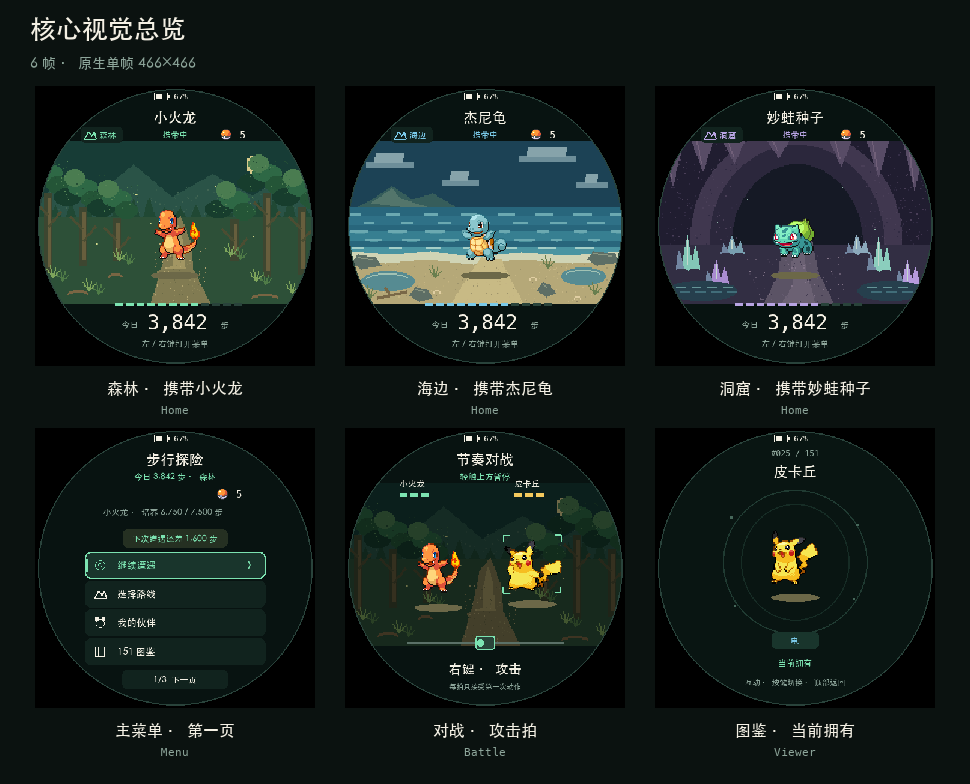
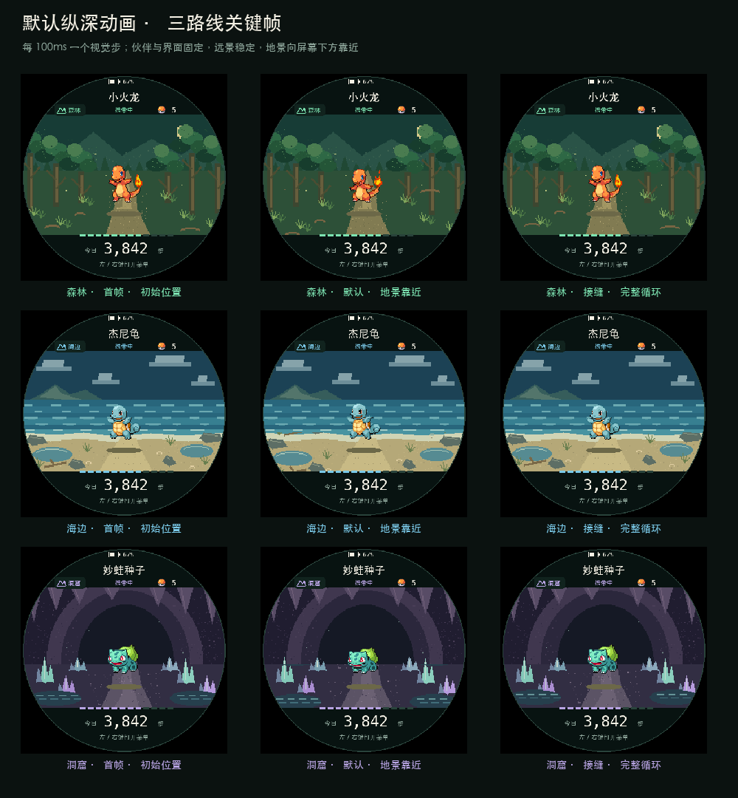

# UI 与地区场景参考

> 当前实现：36 个 `Page`，包括 28 个玩法页面、7 个测试模式页面和语言页。分层场景、步行纵深、进化预览与双角色动作的实现见[UI 实现与设计稿维护](ui-scene-redesign-implementation.md)。
> 图像：独立 Pillow 渲染的历史设计稿，覆盖原 26 页，缺少三张进化／预览页、七张测试模式页和语言页。它们使用仓库生成数据中的 RGB565 素材，但不是 Runtime/M5GFX 截图或实体验收证据；球数、零球和 5000 步等旧示例不代表当前规则。

[打开历史设计画廊](ui-scene-redesign/index.html) · [查看 77 帧与 6 条动画](ui-scene-redesign/manifest.json)

## 页面层级

首页优先回答三个问题：带着谁、走了多少、接下来做什么。其他页面沿用同一套标题、状态、列表和确认规则，不再各自组合颜色和间距。

- 深色背景配合 AMOLED；暖白显示主要内容，薄荷绿表示可操作和选中，琥珀金表示奖励或需要注意，红色只用于错误和不可逆操作。
- 保留《黑／白》像素动画。新场景使用较大的像素块，角色保持清晰，不用插值模糊。
- 主菜单一屏放下全部入口：顶部遭遇横幅、3×2 图标格和底部“返回探索”胶囊；“记录”使用 2×2 图标格。用图标、位置和选中描边区分入口，不加副标题。
- 日期、保存、进化和旧档零球结束本场的提示放在操作之前。不能用颜色代替必要文字。

## 视觉基准

### 颜色

| 角色 | 色值 | 用途 |
| --- | --- | --- |
| 背景 | `#081311` | 页面与图鉴底色 |
| 面板 | `#11231E` | 未选中行、信息区 |
| 选中面板 | `#19352C` | 当前行、当前状态 |
| 主文字 | `#F4F0E4` | 标题、数值、主要操作 |
| 次文字 | `#8DA59A` | 页码、辅助提示 |
| 操作色 | `#7CE3B1` | 选中、可达成的进度 |
| 提醒色 | `#F4C95D` | 遭遇、首捕、待确认 |
| 错误色 | `#FF8278` | 保存失败、存储故障、危险确认 |
| 关都色 | `#8FD46E` | 关都地区 |
| 城都色 | `#F0915A` | 城都地区 |
| 丰缘色 | `#5FD0C8` | 丰缘地区 |
| 神奥色 | `#A9C8F0` | 神奥地区 |
| 合众色 | `#B7A4F0` | 合众地区 |
| 海边色 | `#7AC9E8` | 历史海边记录、水属性信息 |
| 洞窟色 | `#B8A4E3` | 历史洞窟记录 |

地区色用于首页地区标签、“携带中”状态、进度条和“选择地区”中的选中行；历史森林记录使用操作色。颜色只辅助定位；选中行同时有边框和左侧标记，不使用按钮前置功能图标或末尾箭头。

### 圆屏与排版

| 项目 | 设计值 |
| --- | --- |
| 画布 | 历史设计稿 466×466、中心 `(233,233)`；当前 Runtime/M5GFX 画布 468×468，物理圆屏仍为 466×466 |
| 安全区域 | 半径 228，圆外不绘制 |
| 电量 | 顶部中央，避免圆屏上角 |
| 标题 / 副标题 | `y=52 / 80` |
| 列表 | 高 60、最宽 320 的胶囊形按钮（圆角 30）；四角距圆心不超过 220，靠下的行按圆弦收窄（其他页面第三行宽 278）。列表页中心 `y=238,306,374`；绘制与触摸共用 `menu_layout::rowBounds()` |
| 宫格 | 主菜单横幅 300×52（中心 `y=104`），3×2 格 118×96、间距 8（中心 `x=107/233/359`、`y=192/296`），记录 2×2 格 160×84；底部胶囊 180×46（中心 `y=389`）。选中格为强调色双线描边，图标与文字换为强调色；绘制与触摸共用 `menu_layout::hubBounds()` |
| 选中行 | 2px 页面强调色描边、内侧 4×20 圆头标记、文字换为强调色；行内图标中心距左缘 40 |
| 结果页 | 确认按钮中心 `y=372`（捕获）或 `y=355`；地区与捕捉时间合为一行，文字与按钮之间至少留 8px 空白 |
| 列表文字 | 24px；纯文字居中，宝可梦与备注行左右对齐；名称与备注放不下时备注改用 16px |
| 底部翻页 | `y=430`：两侧次文字色箭头 `x=168 / 298`，不加底板。不超过 6 页时用页码点（当前页半径 4、强调色，其余半径 2），更长的列表用 16px 次文字 `当前 / 总数`。触摸区为两侧 90×50（`menu_layout::kPreviousPage / kNextPage`） |
| 对战信息 | 双方名称与生命格放在场景内的胶囊底板 `(76,96)` 与 `(260,96)`，各 130×38；对手靠右镜像排列。节拍轨道底板同为胶囊形 |
| 字号层级 | 标题与列表 24；正文 16；辅助 12–14；关键数字 34–42 |

原型使用 STHeiti 与 Menlo 表达层级，字号作为设计参考。固件中英文文字使用 M5GFX 的 `efontCN_24` 与 `efontCN_16`，部分数字和状态使用内置字体。长名称按可用宽度缩小字号或裁剪，必要警告与操作文字优先完整显示。

## 地区场景

场景源画布为 228×135，以最近邻放大 2 倍到 456×270。固定种子生成纹理，重复生成不会产生随机差异。角色区域保持低对比，标志性建筑和细节放在两侧与远景。场景只表现地区特色，不暗示天气、时间或新的遭遇规则；切换地区只影响下一场遭遇。

| 地区 | 画面结构 | 主色与识别物 | 首页截图 |
| --- | --- | --- | --- |
| 关都 | 晴空白云、远山、红顶与蓝顶小镇、木栅栏、田垄、路牌与土路 | 草绿；红屋顶与栅栏 | [关都](../images/readme/region-kanto.png) |
| 城都 | 黄昏天空、远山、五重塔、鸟居、红叶、石灯笼与石阶路 | 橙红；塔与鸟居 | [城都](../images/readme/region-johto.png) |
| 丰缘 | 冒烟火山、远岛与帆船、海面、椰树、沙滩与贝壳 | 青绿；火山与椰树 | [丰缘](../images/readme/region-hoenn.png) |
| 神奥 | 星空、雪山、针叶林、小木屋、雪原、雪堆与雪径 | 冰蓝；雪山与木屋 | [神奥](../images/readme/region-sinnoh.png) |
| 合众 | 夜空与月亮、城市天际线、斜拉桥、路灯、街道与分道线 | 夜紫；高楼与大桥 | [合众](../images/readme/region-unova.png) |

截图来自真实 Runtime/M5GFX 主机渲染，不是实体屏幕拍摄。下文历史设计画廊仍为原森林、海边、洞窟三路线，只作排版与动效参考；schema7 起这三个名称只出现在旧档的历史捕捉记录中。

主页场景位于 `y=92..361`。伙伴置于中央并下移 10 像素，接触影保持地面原位，前脚和后脚落在同一片影子上，不与脚底分离。底部依次显示遭遇进度、今日步数和当前操作。日期未知时显示“今日 --”，不把累计步数伪装成今日步数。

默认纵深动画固定天空、远景和建筑，只让地面层向屏幕下方靠近。首页每 100ms 推进一次，中层地景下移 1 个源像素，近层地景下移 2 个源像素；不需要走路输入，也不做左右平移。关都、城都、神奥按 51 源像素、丰缘按 45、合众按 49 源像素的地面带高度循环（地面线分别为第 84、84、90、84、86 行）。伙伴、接触影和全部 UI 固定，菜单和熄屏期间暂停。历史三路线的[默认动图](ui-scene-redesign/walking-animation.html)和[关键帧联系表](ui-scene-redesign/contacts/walking-animation.png)展示同一套初始位置、默认位移和循环接缝；时序与实现边界见[运动设计规格](ui-scene-redesign-motion.md)。

场景源图由 `tools/design_preview_scenes.py` 汇总五个地区的确定性绘制。`pixel_scene_layers()` 提供分层，`pixel_scene_motion()` 按整数源像素循环合成；`pixel_scene_source()` 保持原静止画面。`tools/build_scene_backgrounds.py` 生成普通、暗色与分层 RGB565 数据，`assets/scene-backgrounds.json` 保存来源、尺寸和像素哈希。固件按行放大并沿圆屏裁剪，不分配完整场景缓冲；场景上下各 3 个源像素行按 25%、50%、75% 保留的固定点阵过渡到页面底色（`sceneEdgeVisible()`），不引入混色。不得直接编辑 `*_generated.hpp/.cpp`。

## 公共组件

- **标题区**：顶部中央电量；标题和一行状态保持固定位置。适用页面提供顶部返回；首页与“记录”的首捕卡格在精灵球图标右侧显示已捕获种数，口径相同。投球页不显示右上角静态精灵球徽标。
- **列表行**：未选中使用深色填充；选中增加页面强调色边框和左条，“选择地区”中为该地区色。伙伴行使用 40×30 原始图标，放大时为整数倍。
- **状态提示**：只保留当前决策需要的一行。保存失败、步数缺失和备用存档恢复优先于普通提示。
- **记录页**：大数字或首捕角色承担主要内容；日期、UTC 偏移和完整日状态保留，不能简化成无法解释的步数。
- **确认页**：先说明会失去什么，再显示确认与返回。选中态不能替代后果说明；实际选中索引仍由 Runtime 决定。
- **图鉴**：独立 `Viewer` 路径也使用相同颜色与字体层级。拥有、曾经获得和尚未获得不能只靠 sprite 是否显示来区分。

## 页面与运动

[37 个页面清单](ui-scene-redesign-pages.md)列出当前页面、已有设计帧和缺少设计帧的页面；[步行、战斗与捕获规格](ui-scene-redesign-motion.md)说明动作、关键帧和时序。

## 交互与玩法

- `menuCount()` 和 `selected` 由 Runtime 统一管理；主菜单焦点按 `MenuItem` 编号，探索中横幅不可选，`menuSelectable()` 同时约束按键移动、确认和触摸。子页面返回主菜单时恢复进入前的格子，记录详情返回“记录”对应格，校时与语言返回“设置”。
- 首页侧键或触摸打开菜单；普通菜单保留左/右选择和双键确认。按钮在点击释放后执行；列表横滑翻页、底部按钮前后翻页，宫格不分页、横滑不触发；顶部点击返回上一级。
- 每场随机消耗 200–500 探索步产生遭遇，精灵球不限量、每场最多投两球；旧档保留规则版本小于 3 的在途场仍按旧规则用球。
- 进化仍替换原形态、使用目标账户并拒绝已拥有目标。警告文案不能暗示退款或保留原形态。
- 保存失败仍重试同一次结果；提交成功前不显示奖励。存储故障不自动格式化。
- 动画保留原始帧时长、透明键与整数倍缩放。省电时屏幕关闭，不另设计常亮界面。

玩法细节以[使用指南](../usage.md)和[步行培养与存档契约](walking-progression.md)为准。

## 实现与检查

场景与页面的代码归属、设计稿生成命令和覆盖缺口见[UI 实现与设计稿维护](ui-scene-redesign-implementation.md)。自动检查与设备待验事项统一见[验证说明](../verification.md)。
