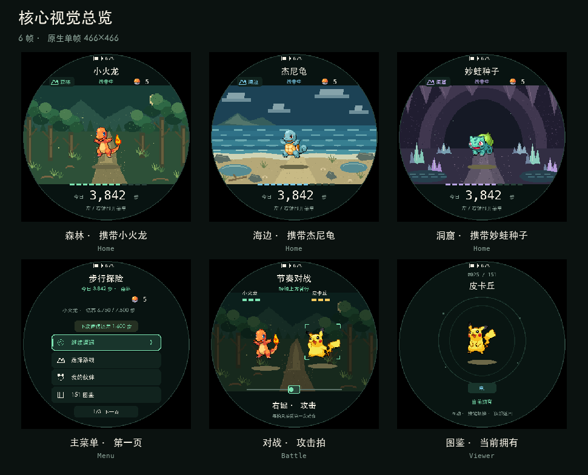

# PokeTrail 全场景与 UI 重设计

> 状态：设计已定稿，场景、25 个页面样式与双角色战斗动作已接入固件。保留原玩法、输入与存档契约；实现细节和验证边界见[实现与验收](ui-scene-redesign-implementation.md)。
> 图像：独立 Pillow 渲染，使用仓库生成数据中的真实 RGB565 像素素材；不是 Runtime/M5GFX 截图，也不是实体 C152 验收证据。页面数据均为示例。

[打开完整视觉画廊](ui-scene-redesign/index.html) · [查看 76 帧与 3 条动画](ui-scene-redesign/manifest.json)

## 设计方向：旅途观测仪

首页优先回答三个问题：带着谁、走了多少、接下来做什么。其他页面沿用同一套标题、状态、列表和确认规则，不再各自组合颜色和间距。

- 深色背景配合 AMOLED；暖白显示主要内容，薄荷绿表示可操作和选中，琥珀金表示奖励或需要注意，红色只用于错误和不可逆操作。
- 保留《黑／白》像素动画。新场景使用较大的像素块，角色保持清晰，不用插值模糊。
- 菜单每页 3 项，使用更大的按钮和文字。资源与数据独立成页，支持首页触摸、顶部返回、前后翻页按钮和横滑翻页。
- 日期、保存、进化和放弃捕捉的警告放在操作之前。不能用颜色代替必要文字。

## 视觉基准

### 颜色

| 角色 | 色值 | 用途 |
| --- | --- | --- |
| 背景 | `#081311` | 页面与图鉴底色 |
| 面板 | `#11231E` | 未选中行、信息区 |
| 选中面板 | `#19352C` | 当前行、当前状态 |
| 主文字 | `#F4F0E4` | 标题、数值、主要操作 |
| 次文字 | `#8DA59A` | 页码、辅助提示 |
| 操作色 | `#7CE3B1` | 选中、可达成的进度 |
| 提醒色 | `#F4C95D` | 遭遇、首捕、待确认 |
| 错误色 | `#FF8278` | 保存失败、存储故障、危险确认 |
| 海边色 | `#7AC9E8` | 海边路线、水属性信息 |
| 洞窟色 | `#B8A4E3` | 洞窟路线 |

森林使用操作色。颜色只辅助定位；选中行同时有边框和左侧标记，不使用按钮前置功能图标或末尾箭头。

### 圆屏与排版

| 项目 | 设计值 |
| --- | --- |
| 原生画布 | 466×466；中心 `(233,233)` |
| 安全区域 | 半径 228，圆外不绘制 |
| 电量 | 顶部中央，避免圆屏上角 |
| 标题 / 副标题 | `y=52 / 80` |
| 列表 | 320×60；中心 `y=238,306,374` |
| 列表文字 | 24px；纯文字居中，宝可梦与备注行左右对齐 |
| 底部翻页 | 前后按钮中心 `x=168 / 298, y=430`；命中区按 `menu_layout.hpp` |
| 字号层级 | 标题与列表 24；正文 16；辅助 12–14；关键数字 34–42 |

原型使用 STHeiti 与 Menlo 表达层级，字号作为设计参考。固件中文使用 M5GFX 的 `efontCN_24` 与 `efontCN_16`，数字与英文使用内置字体。长名称按可用宽度裁剪，必要警告与操作文字优先完整显示。

## 路线场景

场景源画布为 228×135，以最近邻放大 2 倍到 456×270。固定种子生成纹理，重复生成不会产生随机差异。角色区域保持低对比，树皮、泡沫和岩壁等细节放在边缘。场景不暗示新的天气、时间或遭遇规则；切换路线仍只影响下一场遭遇。

| 路线 | 画面结构 | 主色与识别物 | 原画 |
| --- | --- | --- | --- |
| 森林 | 远山、四层树线、分枝树干、根系、蕨叶与萤火 | 林绿；林径石块引导视线 | [森林](ui-scene-redesign/frames/scene-forest.png) |
| 海边 | 多层云、远岛、深浅浪带、碎浪、潮池与岸边草 | 海蓝；泡沫、湿沙反光和贝壳 | [海边](ui-scene-redesign/frames/scene-coast.png) |
| 洞窟 | 多层岩拱、岩壁颗粒、钟乳石、晶簇与地下水面 | 洞紫；晶体亮面、水纹和石径 | [洞窟](ui-scene-redesign/frames/scene-cave.png) |

主页场景位于 `y=92..361`。伙伴置于中央并下移 10 像素，接触影保持地面原位，前脚和后脚落在同一片影子上，不与脚底分离。底部依次显示遭遇进度、今日步数和当前操作。日期未知时显示“今日 --”，不把累计步数伪装成今日步数。

场景源图由 `tools/design_preview_scenes.py` 的 `pixel_scene_source()` 确定性绘制，`tools/build_scene_backgrounds.py` 生成普通与暗色 RGB565 数据，`assets/scene-backgrounds.json` 保存来源、尺寸和像素哈希。固件按行放大并沿圆屏裁剪，不分配完整场景缓冲。不得直接编辑 `*_generated.hpp/.cpp`。

## 公共组件

- **标题区**：顶部中央电量；标题和一行状态保持固定位置。适用页面提供顶部返回，资源与数据页显示路线、球数和培养摘要。
- **列表行**：未选中使用深色填充；选中增加路线色边框和左条。伙伴行使用 40×30 原始图标，放大时为整数倍。
- **状态提示**：只保留当前决策需要的一行。保存失败、步数缺失和备用存档恢复优先于普通提示。
- **记录页**：大数字或首捕角色承担主要内容；日期、UTC 偏移和完整日状态保留，不能简化成无法解释的步数。
- **确认页**：先说明会失去什么，再显示确认与返回。选中态不能替代后果说明；实际选中索引仍由 Runtime 决定。
- **图鉴**：独立 `Viewer` 路径也使用相同颜色与字体层级。拥有、曾经获得和尚未获得不能只靠 sprite 是否显示来区分。

## 页面、战斗与捕获

[25 个页面覆盖](ui-scene-redesign-pages.md)列出全部页面、状态和分组联系表；[战斗与捕获规格](ui-scene-redesign-motion.md)说明动作、关键帧和时序。

## 交互与玩法

- `Page` 包含独立的 `Resources` 页；`menuCount()` 和 `selected` 由 Runtime 统一管理，记录与校时经资源页返回主菜单。
- 首页侧键或触摸打开菜单；普通菜单保留左/右选择和双键确认。菜单按钮在点击释放后执行，横滑只翻页，底部按钮可前后翻页，顶部点击返回上一级。
- 每 5000 探索步产生遭遇，每 1000 总步获得一球，新档零球。
- 进化仍替换原形态、使用目标账户并拒绝已拥有目标。警告文案不能暗示退款或保留原形态。
- 保存失败仍重试同一次结果；提交成功前不显示奖励。存储故障不自动格式化。
- 动画保留原始帧时长、透明键与整数倍缩放。省电时屏幕关闭，不另设计常亮界面。

玩法细节以[使用指南](../usage.md)和[步行培养与存档契约](walking-progression.md)为准。

## 实现与验收

场景生成器、设计预览、固件差异、真实渲染证据和未验证的实机项目见[实现与验收](ui-scene-redesign-implementation.md)。
