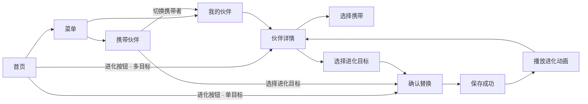

# 步行培养与存档契约

本文维护当前玩法与账户规则；实现接口见[状态与验收](walking-state.md)，旧档兼容见[迁移契约](save-migration.md)。用户操作见[使用指南](../usage.md)，检查入口见[开发指南](../development.md)，实机限制见[验证说明](../verification.md)。

## 玩家会得到什么

一次只携带一只，每种最多拥有一只，当前拥有者都能浏览。每种仅可成功捕获一次；失败可重遇，成功后永久退出遭遇池，进化和重启不恢复资格。初始赠送仍可捕获一次。永久培养账户与进化替换见[培养与收藏账户](#培养与收藏账户)。普通探索使用显式普通池，新增资格选本图鉴范围的初始形态，既有资格保留；神兽、幻兽、迷你龙一家和幼基拉斯留给后续活动。

探索分为关都（#1–151）、城都（#152–251）、丰缘（#252–386）、神奥（#387–493）、合众（#494–649）五个地区，从一开始全部开放，新档默认关都。每个地区只遇见本编号范围内的普通种，普通池依次为 73／51／63／38／69 种。地区只限制遭遇：进化可跨世代，初始伙伴仍为关都三只，捕获练习的对手不受地区限制，背景跟随对手所属地区。地区捕完后不建场、不扣探索步，换到仍有候选的地区即可按已有余额建场。

每累计 **200–500 探索步**（每场随机抽取目标步数）保存一场遭遇，精灵球不限量、默认无限使用。步数跨日保留。已有遭遇时继续积累，处理完当前场后再领取下一场，不覆盖敌方，也不重新抽取当前场。

培养费用按原等级差×500步，道具和交换进化统一10000步；公式见[进化目录](evolution-catalog.md)，常见费用见[使用指南](../usage.md#伙伴与进化)。新档从第一步起积累探索，培养节奏尚未实际试玩验证。

只有携带者得到培养步。携带者至少有一条可执行的进化（步数够、目标未拥有、阶段允许）时，首页伙伴名下方用“进化”按钮替代“携带中”，由玩家确认，不自动替换。培养消费不扣总步、探索进度或精灵球。最终形态仍累计陪伴步数，显示“已是最终形态”。

## 页面和操作

默认首页显示携带伙伴动画、所选地区场景和今日步数。任一侧键或轻触首页进入独立菜单；菜单“选择地区”分两页按世代列出五个地区，选中项预览该地区场景，切换只影响下一场；菜单中的“资源与数据”展示培养进度、已捕获种数和探索状态。已有场可随时继续，额外探索步保留，界面不显示负数倒计时。日期未知时首页显示“今日 --”，累计步数继续保留。

主菜单第二页的“携带伙伴”读取当前已保存的 `partner`，展示物种缩略图、累计培养和可用步数，并按目录列出全部进化目标与费用。不可执行项置灰，选中后说明原因；最终形态与无携带者分别显示对应空态。选择“切换携带者”进入既有伙伴列表，详情携带成功后经列表返回此页，刷新物种与账户；顶部返回和末项返回恢复主菜单的原入口。进化确认取消返回携带伙伴页，成功后沿用进化动画与目标详情。菜单共有十项、四页，第四页为“返回探索”。

“我的伙伴”按图鉴编号分页，只列当前拥有者，标出唯一携带者。初始选择、伙伴列表、详情和进化目标均显示固定来源的物种缩略图，选中项显示2倍预览，列表保留原始40×30像素。详情展示本种累计培养、可用于进化的步数和进化选项。首页与“资源与数据”页在精灵球小图标右侧显示已捕获种数，即 `captureCounts > 0` 的物种数。初始赠送和仅通过进化获得的形态不计入；旧档重复捕获同种只计一种，已捕获的来源进化后仍计入。649 图鉴继续自由浏览，标记“当前拥有／曾获得／未获得”；浏览不授予资格。永久首捕与最近捕捉仍只记录真实捕捉，赠送和进化不制造捕获卡。

首页按钮只响应轻触按钮区域；不可进化时该区域与首页其他位置一样打开菜单，侧键行为不变。单目标直接进入确认页，“稍后”或顶部返回回到首页；多目标打开携带者详情并选中第一条可执行分支。确认页写明“使用 7500 培养步，妙蛙种子变为妙蛙草；种子不再可携带，图鉴记录保留”。“稍后”不消耗。伊布七分支与无畏小子三分支都先选分支，再确认替换；已拥有的分支禁用并说明原因，其他分支仍可选。保留实体按键、触摸和按下释放门，同一次按下不能跨过两次确认。保存成功后播放进化动画，再打开目标详情。

图鉴支持不消耗培养步的自由预览，结束返回原条目。保存重试、预览隔离、时间线与输入规则见[进化动画与图鉴预览](evolution-animation.md)。

进化或切换只在 Walking、EncounterReady，且没有存储失败待重试、校时待确认或活动时间线时执行。Battle（含暂停）、ThrowReady、Resolved 中须先完成或退出相应流程；Resolved 先确认结果。日期未知不阻止培养或进化，只把记录时间记为未知。EncounterReady 切换或进化时同笔更新 `encounter.partner`，敌方、地区、seed、ID不变。

胜利后直接进入投球瞄准态；提示、球位和判定圈见[投球操作](../usage-battle.md#投球)，蓄力与捕获动画中的球保留，不设“准备投球”入口。每场最多两次，成功立即结束，不可提前退出。首次按住右键或触摸才启动窗口；空等不占次数，只保留 ThrowReady、胜利和剩余次数。重启回瞄准态，不恢复 RAM 投球时间线；首页菜单保留“继续捕捉”。

规则版本 1–2 的旧档若球库存为空，投球页显示“本场没有可用精灵球”并只保留一个“结束本场 · 返回探索”按钮，按下即写入 `Result::Released` 并回结果页，避免玩家卡死；该按钮不退回任何球也不记录尝试。

投球交互为按住蓄力、松手投出，判定取松手时刻，蓄力不改变时机窗口或该场规则版本的概率表；按住超过截止时间未松手按超时 Miss 结算并占用一次投球。结算在松手瞬间同步提交存档，提交成功才播放捕获动画；动画是已提交结果的回放，保存失败重试不补播。三幕时序、挣脱派生与结果页版式见[捕获动画](capture-animation.md)。

旧档零球出口仅在无活动投球时可用，不退遭遇步，当前场仍锁定到结果确认。捕获练习随机出现一只宝可梦，使用真实对战、投球判定和每场两次机会，但独立于存档：不写入图鉴、捕捉记录或成就。练习胜利后同样进入瞄准态，轻触投球页顶部结束练习。

## 培养与收藏账户

语言只影响展示，保存与重试规则见[中英文界面契约](i18n.md)。

每种永久保存 `walked`（累计培养）和 `spent`（已用于进化），可用量为 `walked-spent`。进化从来源账户支付，目标使用自己的历史账户。来源剩余步数保留，不能复制或转移到目标。

例：妙蛙种子已有 8000 培养步，花 7500 进化后，种子账户剩 500；第一次获得的妙蛙草从 0 开始。如果种子是尚未捕获的初始赠送，之后唯一一次捕获可恢复它的当前拥有资格及那 500 步。如果已经捕获过，则余额仍保存，但不能靠重捕恢复资格。唯一一次捕获当前已拥有的赠送伙伴也不产生第二只、不清进度、不自动切换携带者。

目标已拥有时整笔进化返回 TargetOwned，双方与培养余额不变；可先让目标继续进化腾出形态。已拥有最终形态的分支无法再生成，本版不提供放生或合并。伊布七分支均为 10000 步，每档仅可捕获一次，故只能选一支；余额留在伊布账户，不能重捕或反复兑现已花步数。

现有 `owned` 位图继续表示当前资格，新增 `registered` 位图表示曾获得并且只增不减：schema2 为 151 种、19 字节的旧布局，schema3–5 为 251 种、32 字节，schema6–8 为 649 种、82 字节。`starter` 仅为一次性领取历史，不再要求仍拥有初始形态。校验要求：

- 有 starter 时 partner 是当前拥有者；无 starter 时 partner 为 0。
- 当前拥有是曾获得的子集。赠送、唯一一次捕获和进化目标均登记曾获得；真实捕获次数大于0只推出曾获得，不要求仍然拥有。旧存档大于1的捕获次数继续有效，但不能再次捕获。
- `0 <= spent <= walked`；未登记物种的培养为 0；各物种培养总和不超过总步。每个有效事件至多归属一个物种。
- 进化不增加总步、捕获次数、首捕或近期捕捉。旧 `owned == 捕获过或starter` 关系必须替换，不能同时保留。
- 超出计数、ID、revision或步数容量时拒绝或显示现有计步缺口；不回绕、不只记总步却漏记培养。乘法、减法和累计求和都先检查界限。

## 进化规则与普通遭遇

进化规则、费用公式、来源快照、`rare`／`weight` 的唯一来源、普通池与地区资格见[进化规则与普通遭遇](evolution-catalog.md)。抽样同时考虑普通资格、捕获历史和当前拥有状态；`routeTypes` 只校验 schema5–6 旧档，schema7 起使用 `regions`。

## 总步、球和探索

规则 3 的球不限量，每场最多投两次，不检查库存，也不增加 `ballsSpent`。旧存档的 `rewardBaseSteps`／`ballsSpent` 保留并可校验；仅仍保留 `ruleVersion < 3` 的在途场按旧规则检查和扣球，规则 2 的当前场会在升级 schema4 时切换为规则 3，再随同一次启动升级到 schema8。相对 `rewardBaseSteps` 每累计 1000 总步仍触发保存；在规则 3 下只用于保存节奏，不发球。

探索账目：新档起每场遭遇消耗一个 200–500 之间的随机目标步数，`explorationSpent + explorationCredit == totalSteps` 恒成立，下一场目标持久化在 `encounterTarget`。累计扣步校验仍兼容迁移前按 5000 步消费的历史场次，具体边界见[迁移契约](save-migration.md#schema3-迁移到-schema4)。午夜、时区变化、进化和换伙伴均不重置余额或目标。

只有 Walking、已选 starter、探索余额至少达到当前目标时创建一场，扣目标步数并保存物种、地区、seed 和 ID，随后为下一场抽取新目标。额外探索步不封顶；重复结果确认必须核对当前 ID，不得重复扣步或重抽。

瞄准态只要求本场还有次数；首次按住才开启 RAM 时间线并把目标时刻定为按住时刻加 1500ms。投出或超时 Miss 占用一次机会，同笔保存已用次数、AttemptKey、判档、概率、roll、捕获与结果，成功不能再第二投。规则版本 3 起概率为普通 85/92/98、稀有 70/80/90、Miss=0；规则版本 1–2 的在途遭遇继续按旧表结算。窗口开启后未结算就重启不占用次数；已经写入的同一尝试不再抽签或发奖励。按住不足 250ms 的误触视为未投出：关闭窗口且不占用次数。判定窗口仍为 Perfect ±70ms、Nice ±120ms、Normal ±180ms。

每跨过一个 1000 步保存触发点，或培养账户可用量达到某条出边费用，都要求在安全时机提交；进化资格只在提交成功后开放。战斗或投球时间线中先排队，在结束或现有安全间隙归账。日期未知照常计培养和探索，日期字段仍未知，之后不补造历史日期。重启后的今日恢复与回拨边界见[时钟恢复](clock-recovery.md)。

## 存档迁移

各版本升级规则（双槽选择与探索余额账式、目录扩容、随机遭遇与无限球、属性路线、649 种目录、地区切换）见[存档迁移契约](save-migration.md)。
