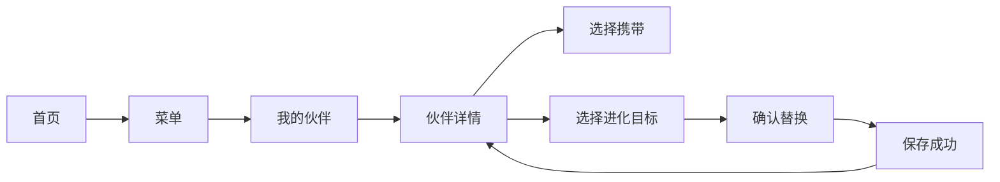

# 步行培养与存档契约

本文维护当前玩法与账户规则；实现接口见[状态与验收](walking-state.md)，旧档兼容见[迁移契约](save-migration.md)。用户操作见[使用指南](../usage.md)，检查入口见[开发指南](../development.md)，实机限制见[验证说明](../verification.md)。

## 玩家会得到什么

一次只携带一只，每种最多拥有一只，所有当前拥有者都能浏览。同种共用永久培养账户。每种仅可成功捕获一次，失败仍可重遇；成功后永久退出所有路线的遭遇池，进化和重启也不恢复资格。初始赠送不算捕获，仍可捕获一次。进化替换原形态，图鉴保留曾获得记录。普通走路只遇本图鉴范围的初始形态；神兽、幻兽和迷你龙一家留给后续活动。

每累计 **5000 探索步**保存一场遭遇，每 **1000 总步**获得一个精灵球。步数跨日保留。已有遭遇时继续积累，处理完当前场后再领取下一场，不覆盖敌方，也不重新抽取当前场。

培养节奏为每个原等级差500步，原道具和交换进化统一10000步。新档初始0球，走到首场时已经获得5球。当前节奏尚未经过实际试玩验证。

| 进化 | 本阶段培养步数 |
| --- | ---: |
| 妙蛙种子 → 妙蛙草 | 7500 |
| 妙蛙草 → 妙蛙花 | 再走 8000 |
| 小火龙 → 火恐龙 | 7500 |
| 火恐龙 → 喷火龙 | 再走 10000 |
| 杰尼龟 → 卡咪龟 | 7500 |
| 卡咪龟 → 水箭龟 | 再走 10000 |
| 鲤鱼王 → 暴鲤龙 | 9500 |
| 皮卡丘 → 雷丘 | 10000 |
| 伊布 → 自选水／雷／火伊布 | 所选分支10000 |

只有携带者得到培养步。达到门槛后提示“可以进化”，由玩家确认，不自动替换。培养消费不扣总步、探索进度或精灵球。最终形态仍累计陪伴步数，显示“已是最终形态”。

## 页面和操作

默认首页显示携带伙伴动画、所选路线场景和今日步数。任一侧键进入独立菜单，菜单展示培养进度、球库存和探索状态。已有场可随时继续，额外探索步保留，界面不显示负数倒计时。日期未知时首页显示“今日 --”，累计步数继续保留。

“我的伙伴”按图鉴编号分页，只列当前拥有者，标出唯一携带者。初始选择、伙伴列表、详情和进化目标均显示固定来源的物种缩略图，选中项显示2倍预览，列表保留原始40×30像素。详情展示本种累计培养、可用于进化的步数和进化选项。菜单与投球页用精灵球小图标显示库存。151 图鉴继续自由浏览，标记“当前拥有／曾获得／未获得”；浏览不授予资格。永久首捕与最近捕捉仍只记录真实捕捉，赠送和进化不制造捕获卡。

确认页写明“使用 7500 培养步，妙蛙种子变为妙蛙草；种子不再可携带，图鉴记录保留”。“稍后”不消耗。伊布先选分支，再确认替换；已拥有的分支禁用并说明原因，其他分支仍可选。保留实体按键、触摸和按下释放门，同一次按下不能跨过两次确认。只在保存成功后展示进化完成。

进化或切换只在 Walking、EncounterReady，且没有存储失败待重试、校时待确认或活动时间线时执行。Battle（含暂停）、ThrowReady、Resolved 中须先完成或退出相应流程；Resolved 先确认结果。日期未知不阻止培养或进化，只把记录时间记为未知。EncounterReady 切换或进化时同笔更新 `encounter.partner`，敌方、路线、seed、ID不变。

胜利后的投球页以精灵球图标和数字显示库存，另显示“本场剩余 Y 次”。每场最多两次，成功立即结束。零球时禁止准备，可选择“保留遭遇，继续走路”或“放弃捕捉”。等待保留 ThrowReady、胜利和剩余次数，回首页继续计步；库存增加后主动回同场投球。Runtime 保存当前场的页面延后状态，`syncPage` 不能每帧把玩家拉回投球页。重启回投球页仍提供等待入口，不恢复已开始的 RAM 投球时间线。

投球交互为按住蓄力、松手投出，判定取松手时刻，时机窗口与概率表不变；按住超过截止时间未松手按超时 Miss 结算并扣球。结算在松手瞬间同步提交存档，提交成功才播放捕获动画；动画是已提交结果的回放，保存失败重试不补播。三幕时序、挣脱派生与结果页版式见[捕获动画](capture-animation.md)。

放弃仅在无活动投球时确认，保存 Released 结果后继续探索，不退球、不退遭遇步。当前场仍锁定到结果确认。捕获练习随机出现一只宝可梦，使用真实对战、投球判定和每场两次机会，但独立于存档：不消耗精灵球，不写入图鉴、捕捉记录或成就。

## 培养与收藏账户

每种永久保存 `walked`（累计培养）和 `spent`（已用于进化），可用量为 `walked-spent`。进化从来源账户支付，目标使用自己的历史账户。来源剩余步数保留，不能复制或转移到目标。

例：妙蛙种子已有 8000 培养步，花 7500 进化后，种子账户剩 500；第一次获得的妙蛙草从 0 开始。如果种子是尚未捕获的初始赠送，之后唯一一次捕获可恢复它的当前拥有资格及那 500 步。如果已经捕获过，则余额仍保存，但不能靠重捕恢复资格。唯一一次捕获当前已拥有的赠送伙伴也不产生第二只、不清进度、不自动切换携带者。

目标当前已拥有时，整笔进化返回 TargetOwned，双方和培养余额都不变。可以先让目标进一步进化腾出该形态。目标为已拥有的最终形态时，该分支无法再生成；本版不新增放生或合并。伊布三支费用均为10000，单份存档只能捕获一次伊布，因此只能选择一条分支。余额保留在伊布账户，不能重捕或反复兑现已花步数。

现有 `owned` 位图继续表示当前资格，新增 `registered[19]` 表示曾获得并且只增不减。`starter` 仅为一次性领取历史，不再要求仍拥有初始形态。校验要求：

- 有 starter 时 partner 是当前拥有者；无 starter 时 partner 为 0。
- 当前拥有是曾获得的子集。赠送、唯一一次捕获和进化目标均登记曾获得；真实捕获次数大于0只推出曾获得，不要求仍然拥有。旧存档大于1的捕获次数继续有效，但不能再次捕获。
- `0 <= spent <= walked`；未登记物种的培养为 0；各物种培养总和不超过总步。每个有效事件至多归属一个物种。
- 进化不增加总步、捕获次数、首捕或近期捕捉。旧 `owned == 捕获过或starter` 关系必须替换，不能同时保留。
- 超出计数、ID、revision或步数容量时拒绝或显示现有计步缺口；不回绕、不只记总步却漏记培养。乘法、减法和累计求和都先检查界限。

## 进化规则与普通遭遇

数据固定为 PokeAPI 提交 `f38eb24b70f8462976154f534e79bf2bdd7af847`，151 种、79 个范围内根、72 条进化边。逐边选择 `version_group_id=1,is_default=1` 的关都普通形态记录，核对来源／目标 form、region 和父关系；匹配歧义即报错。后世宝宝和后继不在当前图鉴范围，因此皮卡丘、胖丁仍作为本图鉴的根。

52 条等级边的费用是 `500 × (目标进化等级 − 来源进入等级)`。根进入等级为 1；有等级入边的来源用该入边等级。20 条道具／交换边统一 10000，原等级保持 null，明确为本游戏改编。若未来出现特殊入边之后再接等级边，必须显式给出进入等级。例：绿毛虫 3000 后铁甲蛹再 1500；合法已有迷你龙 14500 后哈克龙再 12500。界面显示培养步数，不虚构实际等级。

完整72条边、原始CSV行号、费用与来源哈希现保存在产品[evolution-gen1.json](../../assets/evolution-gen1.json)，由[build_evolution_rules.py](../../tools/build_evolution_rules.py)读取固定CSV生成并校验。[来源清单](../../assets/evolution-source/manifest.json)固定三份CSV及哈希。规则与来源扩展在`parents`同级，动画缩放和玩法共用父关系；[build_sprites.py](../../tools/build_sprites.py)继续只读取`parents`。

活动排除集合为急冻鸟、闪电鸟、火焰鸟、迷你龙、哈克龙、快龙、超梦、梦幻（144–151）。普通池由根减去此集合派生，共 73 种：森林 38、海边 22、洞窟 24，路线可重叠，合并恰好 73，进化图共覆盖143种普通形态；该数字是目录可达集合，不表示单份新档能收齐。伊布的一次捕获只能选择一条分支。小火龙、鲤鱼王、墨海马不因外形或名称被排除。

[遭遇目录入口](../../assets/adventure-gen1.json)通过 `speciesFiles` 引用[手工路线配置](../../assets/adventure-routes)。物种按第一条路线分文件，跨路线资格仍由各项 `routes` 完整表达。生成器合并并按编号排序，验证路线、稀有度和正权重。完整151目录供图鉴与旧档校验使用；普通抽样只允许该路线内的普通根且 `captureCounts[id-1] == 0`，再按现有权重抽样，当前未拥有者仍为三倍权重。资格不依赖 `owned`，所以进化后的已捕获来源不会回池。初始赠送的捕获次数为0，仍有唯一一次捕获机会。

路线池耗尽时返回0，Engine不消耗探索步、不发遭遇ID、不创建空物种。换到仍有候选的路线后，可用保留的5000步立即生成下一场。全部普通种捕获后仍可计步、获球和培养，菜单说明当前状态。不能把排除物种的权重改为0来绕过目录校验。已合法拥有的高级形态和活动种继续可浏览、携带、培养，迷你龙可以进化；当前没有活动入口或发放。

## 总步、球和探索

球库存只由 `floor((totalSteps-rewardBaseSteps)/1000)-ballsSpent` 派生，不另存余额或余数。校验要求 `0<=base<=totalSteps`，且已花球数不超过应发数量，先检查再相减。新档 base=0，初始 0 球；尚未选 starter 的已接受总步也产球，培养归属为 0。午夜、时区变化、进化和换伙伴均不重置起点或余数。无人工 99 球上限。

| 新档总步（未花球） | 球库存 | 当前遭遇／额外探索步 |
| --- | ---: | --- |
| 999／1000／1001 | 0／1／1 | 无遭遇，步数全保留 |
| 4999 | 4 | 无遭遇／4999 |
| 5000／5001 | 5 | 首场／0或1 |
| 10000，首场未处理 | 10 | 首场／5000 |

只有 Walking、已选 starter、探索余额至少 5000 时创建一场，扣 5000 并保存物种、路线、seed 和 ID。额外探索步不封顶为 5000；15000 总步且首场未处理时，额外 10000 可在逐场确认后兑换两场。重复结果确认必须核对当前 ID，不得重复扣步或重抽。

每个新周期产 5 球，每场最多用 2 球，所以持续探索会积累球。首场用掉 2 球后，总步到 10000 时第二场开始有 8 球，再用 2 球后剩 6。此设计接受库存增长，不把它描述为稀缺经济，也不增设额外消耗或改变概率。

准备投球要求可用库存至少 1 且本场还有次数，只开启 RAM 时间线。投出或超时 Miss 才扣 1 球；同笔保存 `ballsSpent`、已用次数、AttemptKey、判档、概率、roll、捕获与结果。成功不能再第二投。原普通 55/70/85、稀有 30/45/60、Miss=0 保留。准备后未结算就重启不扣球；已经写入的同一尝试不再扣费、抽签或发奖励。

每跨过一个发球门槛、每个培养账户的可用量首次跨过某条出边费用，都要求在安全时机提交后才向用户提供收益。战斗或投球时间线中先排队，在结束或现有安全间隙归账。日期未知照常计培养、球和探索，日期字段仍未知，之后不补造历史日期。

## 实现与验收

Engine 接口、状态归属、换伙伴前后的步数标签和验证矩阵见[状态与验收](walking-state.md)。

## schema1 迁移到 schema2

双槽选择、探索余额账式、旧免费投球和重复场关闭规则见[存档迁移契约](save-migration.md)。
